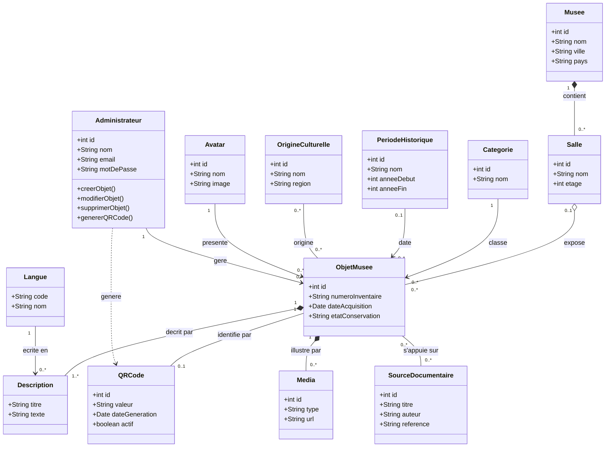
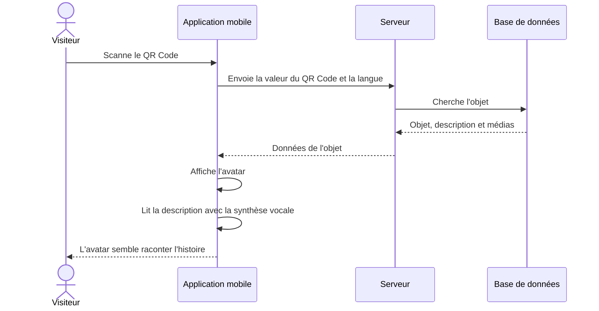
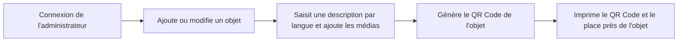

# MNRDC — Modèle de données (UML)

Musée National de la République Démocratique du Congo.

## Le principe

1. L'administrateur enregistre les objets du musée (description, médias) et génère un QR Code pour chacun.
2. Le visiteur scanne le QR Code avec l'application. **Pas de compte, pas de connexion.**
3. L'application affiche l'avatar.
4. En arrière-plan, la description de l'objet est lue à voix haute par une **synthèse vocale** (comme la lecture à voix haute d'Edge pour un PDF).
5. L'avatar ne fait que **donner l'illusion** de raconter l'histoire.

## Règles

- Il y a **un seul avatar par défaut**, utilisé pour tous les objets. Ce n'est pas une IA.
- Il n'y a **pas de conversation** : le visiteur écoute, c'est tout.
- Seul l'**administrateur** a un compte. Il gère les objets, le contenu et les QR Codes.
- Un objet a plusieurs descriptions : **une par langue**.
- Si la description n'existe pas dans la langue choisie, l'application utilise le français.
- Un objet a au plus **un QR Code** (unique), et un QR Code identifie **un seul objet**.

## Diagramme de classes

## Parcours du visiteur

## Parcours de l'administrateur

