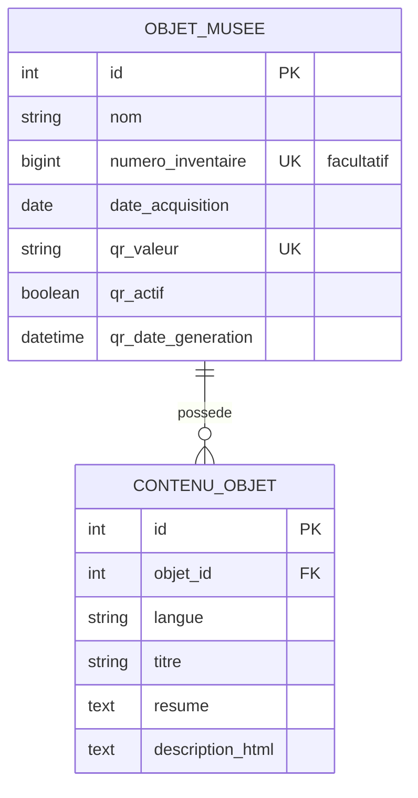

# MNRDC — Modèle de données simplifié

Le catalogue métier repose sur deux tables. Django possède également ses tables techniques pour les comptes et sessions d'administration.

- `ObjetMusee` contient la fiche et son QR Code unique.
- `ContenuObjet` contient le titre, un code langue choisi parmi français, lingala, swahili et anglais, un résumé destiné à la synthèse vocale et la description riche en HTML. Unicité : objet + langue.
- La description est rédigée dans TinyMCE (WYSIWYG), transmise par l'API comme HTML et affichée côté frontend après assainissement.
- Si le contenu demandé n'existe pas, l'API utilise le français ; sans contenu français, elle retourne `404`.
- Le backend n'envoie ni médias ni avatar.
