# MCD — Modèle Conceptuel de Données du projet MNRDC

> **Musée National de la République Démocratique du Congo — Plateforme numérique intelligente**
>
> | | |
> |---|---|
> | **Document** | `mcd.md` — Modélisation conceptuelle des données (méthode Merise) |
> | **Version** | 1.0 — proposition soumise à relecture |
> | **Date** | 7 novembre 2026 |
> | **Étape suivante** | MLD → MPD → implémentation (hors périmètre de ce document) |
> | **Diagrammes** | Tous rédigés en Mermaid (`erDiagram`, `flowchart`, `sequenceDiagram`, `stateDiagram-v2`) |

---

## Sommaire

1. [Présentation du projet](#1-présentation-du-projet)
2. [Objectifs du MCD](#2-objectifs-du-mcd)
3. [Périmètre fonctionnel](#3-périmètre-fonctionnel)
4. [Hypothèses de conception et ambiguïtés](#4-hypothèses-de-conception-et-ambiguïtés)
5. [Règles de gestion](#5-règles-de-gestion)
6. [Conventions de lecture](#6-conventions-de-lecture)
7. [Dictionnaire des données](#7-dictionnaire-des-données)
8. [Liste des entités et attributs (synthèse)](#8-liste-des-entités-et-attributs-synthèse)
9. [Liste des associations et cardinalités](#9-liste-des-associations-et-cardinalités)
10. [Diagramme MCD global](#10-diagramme-mcd-global)
11. [Diagrammes fonctionnels](#11-diagrammes-fonctionnels)
12. [Justification des choix de modélisation](#12-justification-des-choix-de-modélisation)
13. [Contraintes d'intégrité conceptuelles](#13-contraintes-dintégrité-conceptuelles)
14. [Perspectives d'évolution](#14-perspectives-dévolution)
15. [Conclusion](#15-conclusion)

---

## 1. Présentation du projet

**MNRDC** est une plateforme numérique destinée à moderniser l'expérience des visiteurs du Musée National de la République Démocratique du Congo. Elle rend le patrimoine culturel congolais accessible et compréhensible par tous, quels que soient l'âge, la langue ou le niveau de connaissance du visiteur.

### Principe de fonctionnement

1. Chaque objet exposé est enregistré dans la base de données patrimoniale.
2. Chaque objet exposé peut porter un **QR Code** unique et actif.
3. Le visiteur scanne ce QR Code avec l'**application mobile MNRDC**.
4. L'application identifie l'objet correspondant.
5. Une interface interactive présente un **avatar virtuel** associé à l'objet.
6. L'avatar raconte l'histoire de l'objet : origine, signification culturelle, usage traditionnel, caractéristiques historiques. Le visiteur peut ensuite dialoguer avec lui.

### Enjeux propres à ce projet

| Enjeu | Conséquence sur la modélisation |
|---|---|
| Le patrimoine est un **savoir documenté**, parfois contesté ou sensible | Sources documentaires obligatoires, niveaux de certitude, niveaux de sensibilité, validation par des personnes habilitées |
| Le pays est **multilingue** (français, lingala, swahili, kikongo, tshiluba, anglais…) | Structure de traduction extensible : ajouter une langue ne modifie pas le modèle |
| Un avatar s'appuie sur de l'**intelligence artificielle** | Versionnement des avatars, traçabilité des messages, ancrage des réponses dans des informations validées |
| Le premier déploiement est le MNRDC, mais la plateforme doit **s'étendre** | Plusieurs musées, plusieurs salles, plusieurs avatars, plusieurs langues dès la conception |

---

## 2. Objectifs du MCD

1. **Décrire le sens des données**, indépendamment de toute technique : entités, associations, cardinalités, contraintes métier.
2. **Servir de contrat** entre l'équipe métier (conservation, médiation) et l'équipe technique.
3. **Préparer le passage au MLD, au MPD puis à l'implémentation** sans réinterprétation.
4. **Éviter la redondance** et respecter la normalisation dès le niveau conceptuel.
5. **Distinguer clairement** les quatre domaines de données demandés (patrimoine, gestion du musée, visiteurs, intelligence artificielle) et isoler les mécanismes transversaux (multilinguisme, traçabilité).
6. **Documenter les ambiguïtés** et les hypothèses retenues pour qu'elles puissent être contestées.

Ce document **ne contient ni SQL, ni types propres à un SGBD, ni clés étrangères techniques** : ce sont des objets du MLD et du MPD.

---

## 3. Périmètre fonctionnel

### 3.1 Dans le périmètre

| Domaine | Fonctions couvertes |
|---|---|
| **Patrimoine** | Catalogue des objets, classification, datation, origines culturelles, matériaux, médias, informations historiques sourcées, récits, validation scientifique |
| **Gestion du musée** | Musées, salles, emplacements, historique de placement des objets, QR Codes, comptes, rôles, permissions, affectations |
| **Visiteurs** | Profil visiteur (y compris anonyme), scans, consultations d'histoires, favoris |
| **Intelligence artificielle** | Avatars, versions d'avatars, langues parlées, conversations, messages, traçabilité des réponses |
| **Transversal** | Langues, traductions, journal de traçabilité des modifications |

### 3.2 Hors périmètre (volontairement)

- Billetterie, paiement, réservation de visites.
- Prêts d'objets vers des institutions externes (voir hypothèse H07).
- Gestion fine des collections (assurance, restauration détaillée, constat d'état).
- Statistiques agrégées : ce sont des **données dérivées**, calculées à partir des scans et consultations (voir § 13.3).
- Infrastructure de l'IA (index vectoriels, embeddings, modèles) : objets du MPD ou de l'architecture applicative.
- Interfaces utilisateur.

---

## 4. Hypothèses de conception et ambiguïtés

### 4.1 Hypothèses retenues

| Réf. | Hypothèse |
|---|---|
| **H01** | La plateforme est **multi-musées** dès la conception. Le MNRDC est le premier musée déployé. |
| **H02** | Un visiteur peut utiliser l'application **sans créer de compte**. Il reçoit alors un compte de statut « anonyme » créé automatiquement : tout visiteur est donc rattaché à un `UTILISATEUR`. |
| **H03** | « Administrateur » et « Conservateur » sont des **rôles** (données paramétrables), et non des entités distinctes. Cela évite des entités redondantes et permet de créer de nouveaux rôles sans changer le modèle. |
| **H04** | Tout **texte destiné au public** (nom d'un objet, description, récit, légende…) est stocké dans `TRADUCTION`. Les entités patrimoniales ne portent que des données **neutres** (codes, dates, dimensions). La langue d'origine est une traduction de nature « original ». |
| **H05** | Un objet est présenté par **au plus un avatar à un instant donné**. Un avatar peut présenter **plusieurs objets**. L'évolution d'un avatar est portée par ses versions, pas par un changement d'avatar. |
| **H06** | L'historique des contenus textuels est conservé par le **journal de traçabilité**, pas par une duplication de versions complètes dans le MCD. |
| **H07** | Les **prêts externes** et sorties temporaires d'objets sont hors périmètre. Un objet est toujours placé dans un emplacement d'un musée de la plateforme (y compris en réserve). |
| **H08** | Certaines connaissances sont **sensibles** (savoirs initiatiques, objets sacrés). Chaque information historique porte un niveau de sensibilité ; seules les informations de niveau « public » peuvent être restituées aux visiteurs. |
| **H09** | Le QR Code encode un **jeton opaque** (valeur non devinable), jamais l'identifiant interne de l'objet. Le jeton peut être remplacé sans changer l'objet. |
| **H10** | L'avatar ne **crée pas de faits** : ses réponses s'appuient sur des informations historiques validées et publiques. |
| **H11** | Les contenus de nature scientifique (informations, histoires) sont soumis à validation. Les autres textes (par exemple le nom d'une salle) relèvent de la responsabilité administrative, sans workflow de validation. |
| **H12** | Le traitement des données personnelles des visiteurs (consentement, minimisation) devra être confirmé avec le cadre juridique congolais en vigueur. Le MCD prévoit les attributs de consentement. |

### 4.2 Ambiguïtés identifiées et décisions

| Réf. | Ambiguïté | Décision | Impact |
|---|---|---|---|
| **A01** | `Administrateur` figure dans la liste des entités de départ, mais le cahier des charges parle aussi de « conservateur autorisé » | Modélisés comme **rôles** (`ROLE`) attribués par `AFFECTATION` à un `PERSONNEL_MUSEE` | Extensible, pas de duplication |
| **A02** | Différence entre `Visiteur` et `Utilisateur` | `UTILISATEUR` = compte (supertype). `VISITEUR` et `PERSONNEL_MUSEE` en sont les deux sous-types, exclusifs et totaux | Un seul mécanisme de compte |
| **A03** | « Un avatar peut présenter plusieurs objets *si le modèle retenu le permet* » | Le modèle retenu le **permet** : objet (0,1) ↔ avatar (0,N) | Un avatar par culture ou par thème est possible |
| **A04** | Distinction `InformationHistorique` / `HistoireObjet` | **Information** = fait documenté et sourcé (unité de connaissance). **Histoire** = récit destiné à être raconté, composé à partir d'informations | Les sources s'attachent aux faits, pas aux récits |
| **A05** | Un `Scan` porte-t-il sur un QR Code ou sur un objet ? | Sur un **QR Code** ; l'objet est **dérivé** (QR Code → objet). Cela évite une redondance et conserve la trace du QR Code réellement lu | Un scan raté (jeton inconnu) reste enregistrable |
| **A06** | « QR Code unique et actif » | Un QR Code identifie un seul objet, pour toujours. Un objet peut avoir plusieurs QR Codes **dans le temps** (remplacement), **un seul actif** | Historique des QR Codes |
| **A07** | « Un objet peut être associé à plusieurs langues » | Pas d'association objet–langue. Les langues d'un objet sont **dérivées** de ses traductions restituables | Pas de duplication |
| **A08** | `ValidationHistorique` porte sur quoi ? | Sur **une** cible parmi information, histoire ou traduction (contrainte d'exclusion totale CI-03) | Validation scientifique, culturelle ou linguistique |
| **A09** | Traçabilité des modifications | Entité `JOURNAL_MODIFICATION` à référence **descriptive** (non relationnelle) à l'occurrence modifiée, afin de survivre à l'archivage | Cas assumé de référence faible |
| **A10** | Associations ternaires et associations porteuses d'attributs | Merise les admet. **Mermaid ne sait représenter que des associations binaires sans attributs** : elles sont dessinées comme **entités associatives** (voir § 6.3) | Convention de lecture |
| **A11** | Un jeton scanné inconnu | Le scan est enregistré avec la valeur lue ; le lien vers `QR_CODE` est alors absent (0,1) | Utile pour détecter les QR Codes contrefaits ou erronés |
| **A12** | Partage d'un média entre plusieurs éléments | Un média est rattaché à **un seul** élément. Le partage est une évolution possible (§ 14) | Simplicité |

---

## 5. Règles de gestion

Les règles sont numérotées par domaine. Les références **CI-xx** renvoient aux contraintes d'intégrité du § 13.

### 5.1 Patrimoine

| Réf. | Règle |
|---|---|
| **RG-P01** | Tout objet muséal possède un **identifiant unique** (`id_element`). Son **numéro d'inventaire** est unique au sein d'un musée (CI-04). |
| **RG-P02** | Un objet appartient à **exactement un musée** (celui qui le conserve) et à **exactement une catégorie**. |
| **RG-P03** | Un objet a **au plus une période historique**, **zéro à plusieurs origines culturelles** et **zéro à plusieurs matériaux**. |
| **RG-P04** | Les catégories et les origines culturelles sont **hiérarchiques** (au plus un parent) et sans cycle (CI-21). |
| **RG-P05** | Un objet peut avoir **plusieurs médias** (images, vidéos, audios, modèles 3D, documents). Un média est rattaché à **un seul élément** (CI-22). |
| **RG-P06** | Un objet peut avoir **plusieurs informations historiques documentées**. Une information concerne **un seul objet**. |
| **RG-P07** | Toute information historique est étayée par **au moins une source documentaire** (CI-19). Les sources sont **conservées** : elles ne sont jamais fusionnées dans le texte. |
| **RG-P08** | Une histoire concerne **un seul objet** et s'appuie sur **au moins une information** de cet objet (CI-18). Un objet peut avoir **plusieurs histoires** (récit complet, version enfant, version experte…). |
| **RG-P09** | Une information est **sensible** si son niveau de sensibilité n'est pas « public ». Elle est documentée en interne mais **jamais restituée** aux visiteurs ni citée par un avatar (CI-33). |
| **RG-P10** | Une information ou une histoire n'est **restituable** qu'après une **validation approuvée** postérieure à sa dernière modification (CI-31). |
| **RG-P11** | Aucun élément référencé n'est supprimé physiquement : il est **archivé** (`est_archive`). L'historique reste cohérent (CI-35). |

### 5.2 Multilinguisme

| Réf. | Règle |
|---|---|
| **RG-L01** | Une **langue** peut être ajoutée, activée ou désactivée **sans modifier le modèle** (aucune structure ne dépend d'une langue précise). |
| **RG-L02** | Tout texte public est une **traduction** identifiée par le couple (élément, langue) (CI-08). |
| **RG-L03** | Chaque élément possède **au moins une traduction** et **exactement une traduction de nature « original »** (CI-20). |
| **RG-L04** | Une traduction non originale n'est restituable qu'après une **validation linguistique approuvée** postérieure à sa dernière modification. |
| **RG-L05** | Les **langues associées à un objet** sont celles pour lesquelles il dispose d'une traduction restituable : cette liste est **calculée**, jamais saisie. |
| **RG-L06** | Si la langue demandée n'est pas disponible, la restitution applique la **chaîne de repli** : langue demandée → langue préférée du compte → langue d'origine (voir diagramme § 11.6). |
| **RG-L07** | Un média audio ou vidéo peut être **propre à une langue** (narration) ; un média sans langue est neutre. |

### 5.3 Gestion du musée

| Réf. | Règle |
|---|---|
| **RG-G01** | La plateforme gère **plusieurs musées**. Une salle appartient à **un seul musée**. Le code d'une salle est unique dans son musée (CI-05). |
| **RG-G02** | Un emplacement appartient à **une seule salle**. Son code est unique dans sa salle (CI-06). |
| **RG-G03** | La position d'un objet est **historisée** : chaque placement est daté. Un objet a **au plus un placement courant** (CI-15) et l'emplacement courant doit appartenir au musée de l'objet (CI-17). |
| **RG-G04** | Un emplacement accueille au plus `capacite_max` objets simultanément (CI-16). |
| **RG-G05** | Un objet est **exposé** si son placement courant est dans une salle de type « exposition » (donnée dérivée). |
| **RG-G06** | Un **QR Code** identifie **un seul objet**, de façon définitive (CI-14). Sa valeur est unique (CI-07). |
| **RG-G07** | Un objet a **au plus un QR Code actif** (CI-12) et un QR Code ne peut être actif que si l'objet est exposé (CI-13). |
| **RG-G08** | Toute création, modification, validation, désactivation ou archivage est **tracé** dans le journal (CI-34). |

### 5.4 Utilisateurs, rôles et droits

| Réf. | Règle |
|---|---|
| **RG-U01** | Tout utilisateur est **soit visiteur, soit membre du personnel** (CI-02). |
| **RG-U02** | Les droits sont portés par des **permissions** regroupées en **rôles**. Un rôle regroupe au moins une permission. |
| **RG-U03** | Un membre du personnel reçoit ses rôles par des **affectations datées**, limitées à un musée ou valables pour toute la plateforme selon la portée du rôle (CI-30). |
| **RG-U04** | Un **administrateur ou un conservateur autorisé** peut créer, modifier et valider des informations patrimoniales **s'il détient la permission correspondante** au moment de l'action (CI-31). |
| **RG-U05** | **Séparation des tâches** : la personne ayant rédigé ou modifié un contenu ne peut pas le valider (CI-31). |
| **RG-U06** | Une validation est de type **scientifique**, **culturelle** ou **linguistique**, et correspond à une permission distincte. |

### 5.5 Visiteurs

| Réf. | Règle |
|---|---|
| **RG-V01** | Un visiteur peut **scanner plusieurs objets**, et **le même objet plusieurs fois**. Chaque scan est enregistré (CI-29). |
| **RG-V02** | Un scan est enregistré **même en cas d'échec** (jeton inconnu, QR Code désactivé, objet non exposé, contenu indisponible). |
| **RG-V03** | Un visiteur peut **consulter plusieurs histoires**. Une consultation peut être déclenchée par un scan, ou non (recherche, favori). |
| **RG-V04** | Un visiteur peut mettre **plusieurs objets en favori**. Un objet n'est favori qu'une fois par visiteur (CI-09). |
| **RG-V05** | L'exploitation statistique des usages d'un visiteur exige son **consentement** (`consentement_analytique`). |

### 5.6 Intelligence artificielle

| Réf. | Règle |
|---|---|
| **RG-I01** | Un avatar est **versionné**. Il possède au moins une version, et **au plus une version « en production »** à la fois (CI-23). |
| **RG-I02** | Un objet est présenté par **zéro ou un avatar** ; un avatar peut présenter **plusieurs objets**. L'association n'est effective que si l'avatar est actif et dispose d'une version en production (CI-24). |
| **RG-I03** | Une version d'avatar déclare les **langues qu'elle sait parler**, avec la référence de voix et un niveau de qualité. |
| **RG-I04** | Une **conversation** met en relation **un visiteur** et **une version d'avatar**, dans **une langue** (CI-26). |
| **RG-I05** | Une conversation **contient plusieurs messages**, ordonnés (CI-27). |
| **RG-I06** | Une conversation **conserve la version d'avatar** utilisée : la trace reste exacte même après évolution de l'avatar. |
| **RG-I07** | Un message émis par l'avatar **référence les informations historiques** sur lesquelles il s'appuie. Ces informations sont validées et publiques (CI-28). |
| **RG-I08** | Un message est soumis à un **statut de modération**. |

---

## 6. Conventions de lecture

### 6.1 Natures de données

Le MCD n'utilise que des **natures conceptuelles** : `Identifiant`, `Texte`, `Entier`, `Décimal`, `Date`, `Date-heure`, `Booléen`, `Liste` (ensemble fermé de valeurs, détaillé dans la description). Aucun type SQL n'est utilisé.

Dans les diagrammes Mermaid, ces natures s'écrivent sans accent : `identifiant`, `texte`, `entier`, `decimal`, `date`, `dateheure`, `booleen`, `liste`.

### 6.2 Identifiants dans les diagrammes

Mermaid impose d'écrire un type et propose des marqueurs de clé. Ils sont **détournés ici de leur sens technique** :

| Marqueur | Sens dans ce document |
|---|---|
| `PK` | Fait partie de l'**identifiant** de l'entité (conceptuel, pas une clé primaire technique) |
| `UK` | **Identifiant naturel** (unique) |
| *(aucun marqueur)* | Attribut simple |

Aucun `FK` n'apparaît : en Merise, le lien entre entités est porté par l'**association**.

### 6.3 Associations, cardinalités et représentation Mermaid

**Cardinalités Merise.** Dans le tableau du § 9, la cardinalité écrite en face de l'entité A est le nombre d'occurrences de B associées à **une** occurrence de A. Exemple : `MUSEE (0,N) — SALLE (1,1)` signifie qu'un musée a de zéro à N salles et qu'une salle appartient à exactement un musée.

**Lecture dans Mermaid.** Dans `A <symbole gauche>--<symbole droit> B`, on lit : « **une occurrence de A est associée à [symbole droit] occurrence(s) de B** » et « **une occurrence de B est associée à [symbole gauche] occurrence(s) de A** ».

| Symbole Mermaid | Cardinalité Merise |
|---|---|
| `\|\|` (ou `\|\|`) | (1,1) |
| `\|o` / `o\|` | (0,1) |
| `}o` / `o{` | (0,N) |
| `}\|` / `\|{` | (1,N) |

**Style de trait.** Trait plein `--` : dépendance forte (l'occurrence n'existe pas sans son parent, ou entité associative). Trait pointillé `..` : référence simple.

**Entités associatives.** Les associations porteuses d'attributs ou ternaires sont représentées par une entité nommée comme l'association : `TRADUCTION`, `PLACEMENT`, `APPUI_DOCUMENTAIRE`, `AFFECTATION`, `FAVORI`, `LANGUE_AVATAR`. Elles sont signalées « **association** » dans le dictionnaire.

**Généralisation.** Une généralisation (supertype / sous-types) est dessinée par une relation `supertype ||--o| sous-type`. Les sous-types **héritent de l'identifiant** du supertype.

**Contraintes non dessinables.** Mermaid ne représente pas les contraintes de partition, d'exclusion ou de cohérence : elles sont listées dans les légendes de diagrammes et au § 13.

**Lisibilité.** Les diagrammes montrent l'identifiant et les attributs structurants. La liste **exhaustive** des attributs est au § 7. Aucun attribut ni aucune entité d'un diagramme n'est absent du dictionnaire.

---

## 7. Dictionnaire des données

> **Colonne « Obl. »** : **O** = obligatoire (au moins 1 valeur), **F** = facultatif.
> **Domaines** : **P** Patrimoine · **G** Gestion du musée · **V** Visiteurs · **I** Intelligence artificielle · **T** Transversal.

### 7.1 Transversal

#### ELEMENT_CONTENU — Élément de contenu (supertype)

- **Domaine** : T — **Type** : supertype abstrait (généralisation exclusive et totale, CI-01).
- **Description** : toute chose qui porte des textes traduisibles et des médias. Il centralise ces deux besoins pour éviter de les répéter dans chaque entité.
- **Sous-types** : `MUSEE`, `SALLE`, `OBJET_MUSEAL`, `CATEGORIE_OBJET`, `PERIODE_HISTORIQUE`, `ORIGINE_CULTURELLE`, `MATERIAU`, `MEDIA`, `INFORMATION_HISTORIQUE`, `HISTOIRE_OBJET`, `AVATAR`.
- **Identifiant** : `id_element`.

| Attribut | Description | Nature | Obl. |
|---|---|---|---|
| `id_element` | Identifiant unique, hérité par tous les sous-types | Identifiant | O |
| `est_archive` | Archivage logique : un élément archivé n'est plus restitué mais reste référencé | Booléen | O |

#### LANGUE — Langue

- **Domaine** : T. **Description** : langue dans laquelle un contenu peut être exprimé ou parlé.
- **Identifiant** : `code_langue` (code de langue normalisé, par exemple `fra`, `lin`, `swa`, `kon`, `lua`, `eng`).

| Attribut | Description | Nature | Obl. |
|---|---|---|---|
| `code_langue` | Code normalisé de la langue | Identifiant | O |
| `nom_francais` | Nom de la langue en français | Texte | O |
| `nom_natif` | Nom de la langue dans cette langue | Texte | F |
| `statut_linguistique` | Liste : officielle, nationale, locale, internationale | Liste | O |
| `sens_ecriture` | Liste : gauche-droite, droite-gauche | Liste | O |
| `est_active` | Langue proposée aux visiteurs | Booléen | O |

#### TRADUCTION — Traduction *(association ELEMENT_CONTENU × LANGUE)*

- **Domaine** : T. **Description** : version textuelle d'un élément dans une langue. Porte tout le texte destiné au public.
- **Identifiant** : composé de `id_element` et `code_langue`.

| Attribut | Description | Nature | Obl. |
|---|---|---|---|
| `intitule` | Nom, titre ou libellé de l'élément dans cette langue | Texte | O |
| `resume` | Texte court (aperçu, légende, texte alternatif d'un média) | Texte | F |
| `texte_complet` | Texte long (description, récit, énoncé du fait) | Texte | F |
| `nature_texte` | Liste : original, traduction humaine, traduction automatique | Liste | O |
| `date_derniere_modification` | Sert à vérifier qu'une validation est postérieure au texte | Date-heure | O |

#### JOURNAL_MODIFICATION — Journal de traçabilité

- **Domaine** : T. **Description** : trace immuable de chaque opération significative. La référence à l'occurrence modifiée est **descriptive** (voir A09).
- **Identifiant** : `id_journal`.

| Attribut | Description | Nature | Obl. |
|---|---|---|---|
| `id_journal` | Identifiant de l'entrée | Identifiant | O |
| `date_operation` | Moment de l'opération | Date-heure | O |
| `type_operation` | Liste : création, modification, archivage, validation, révocation, activation, désactivation | Liste | O |
| `entite_concernee` | Nom de l'entité conceptuelle touchée | Texte | O |
| `occurrence_concernee` | Identifiant de l'occurrence touchée, sous forme de texte | Texte | O |
| `resume_changement` | Description lisible du changement | Texte | F |
| `valeur_avant` | Valeur avant modification | Texte | F |
| `valeur_apres` | Valeur après modification | Texte | F |

### 7.2 Patrimoine

#### OBJET_MUSEAL — Objet muséal *(sous-type de ELEMENT_CONTENU)*

- **Domaine** : P. **Description** : pièce de la collection d'un musée, unité centrale du système.
- **Identifiant** : `id_element` (hérité). **Identifiant naturel** : (musée, `numero_inventaire`).
- **Contenu traduisible** : titre (`intitule`) et description (`texte_complet`).

| Attribut | Description | Nature | Obl. |
|---|---|---|---|
| `numero_inventaire` | Numéro d'inventaire officiel, unique dans le musée | Texte | O |
| `date_acquisition` | Date d'entrée dans la collection | Date | F |
| `mode_acquisition` | Liste : don, achat, collecte, dépôt, legs, inconnu | Liste | F |
| `etat_conservation` | Liste : excellent, bon, moyen, fragile, en restauration | Liste | O |
| `hauteur_cm`, `largeur_cm`, `profondeur_cm` | Dimensions en centimètres | Décimal | F |
| `poids_g` | Poids en grammes | Décimal | F |
| `datation_precise` | Datation libre (« vers 1890 », « XIXe siècle ») ; la période structurée est portée par `PERIODE_HISTORIQUE` | Texte | F |
| `notes_internes` | Remarques de conservation, jamais diffusées | Texte | F |

#### CATEGORIE_OBJET — Catégorie d'objet *(sous-type)*

- **Domaine** : P. **Description** : classification hiérarchique (masques, statuettes, instruments de musique, vannerie…).
- **Identifiant** : `id_element` (hérité). **Identifiant naturel** : `code_categorie`.

| Attribut | Description | Nature | Obl. |
|---|---|---|---|
| `code_categorie` | Code mnémonique unique | Texte | O |
| `ordre_affichage` | Position dans les listes | Entier | F |

#### PERIODE_HISTORIQUE — Période historique *(sous-type)*

- **Domaine** : P. **Description** : intervalle d'histoire (préhistoire, royaumes précoloniaux, période coloniale, indépendance…).
- **Identifiant** : `id_element` (hérité). **Identifiant naturel** : `code_periode`.

| Attribut | Description | Nature | Obl. |
|---|---|---|---|
| `code_periode` | Code mnémonique unique | Texte | O |
| `annee_debut` | Année de début (négative avant l'ère commune) | Entier | F |
| `annee_fin` | Année de fin ; doit être supérieure ou égale au début (CI-32) | Entier | F |

#### ORIGINE_CULTURELLE — Origine culturelle *(sous-type)*

- **Domaine** : P. **Description** : peuple, royaume, communauté, région ou atelier dont l'objet est issu. Hiérarchique.
- **Identifiant** : `id_element` (hérité). **Identifiant naturel** : `code_origine`.

| Attribut | Description | Nature | Obl. |
|---|---|---|---|
| `code_origine` | Code mnémonique unique | Texte | O |
| `type_origine` | Liste : peuple, royaume, communauté, région, atelier | Liste | O |
| `zone_geographique` | Zone actuelle d'implantation | Texte | F |
| `latitude_reference`, `longitude_reference` | Point de référence pour la cartographie | Décimal | F |

#### MATERIAU — Matériau *(sous-type)*

- **Domaine** : P. **Description** : matière constitutive. Entité séparée pour éviter un attribut multivalué sur l'objet (1re forme normale).
- **Identifiant** : `id_element` (hérité). **Identifiant naturel** : `code_materiau`.

| Attribut | Description | Nature | Obl. |
|---|---|---|---|
| `code_materiau` | Code mnémonique unique | Texte | O |
| `famille_materiau` | Liste : bois, métal, textile, fibre végétale, céramique, pierre, os ou ivoire, composite, autre | Liste | O |

#### MEDIA — Média *(sous-type)*

- **Domaine** : P. **Description** : ressource numérique : image, vidéo, audio, modèle 3D, document. Légende et texte alternatif sont des traductions.
- **Identifiant** : `id_element` (hérité).

| Attribut | Description | Nature | Obl. |
|---|---|---|---|
| `type_media` | Liste : image, video, audio, modele_3d, document | Liste | O |
| `role_media` | Liste : principal, galerie, vignette, narration, ressource_avatar | Liste | O |
| `ordre_affichage` | Ordre dans une galerie | Entier | F |
| `reference_fichier` | Référence logique du fichier numérique | Texte | O |
| `format_media` | Format du fichier (par exemple JPEG, MP4) | Texte | F |
| `duree_secondes` | Durée des médias audio et vidéo | Entier | F |
| `credit_droits` | Crédit et conditions d'utilisation | Texte | F |

#### INFORMATION_HISTORIQUE — Information historique *(sous-type)*

- **Domaine** : P. **Description** : fait documenté sur un objet (unité de connaissance). C'est l'entité **sourcée** et **validée**. Son énoncé est une traduction.
- **Identifiant** : `id_element` (hérité).

| Attribut | Description | Nature | Obl. |
|---|---|---|---|
| `type_information` | Liste : origine, fabrication, usage traditionnel, signification culturelle, provenance et collecte, conservation, anecdote | Liste | O |
| `epoque_evoquee` | Époque ou date concernée par le fait (texte libre) | Texte | F |
| `niveau_certitude` | Liste : établi, probable, hypothese, tradition orale | Liste | O |
| `niveau_sensibilite` | Liste : public, restreint, sacré (voir RG-P09) | Liste | O |
| `date_derniere_modification` | Sert à vérifier qu'une validation est postérieure | Date-heure | O |

#### HISTOIRE_OBJET — Histoire d'un objet *(sous-type)*

- **Domaine** : P. **Description** : récit raconté par l'avatar, composé à partir d'informations historiques. Son titre et son texte sont des traductions.
- **Identifiant** : `id_element` (hérité).

| Attribut | Description | Nature | Obl. |
|---|---|---|---|
| `type_recit` | Liste : complet, résumé, version enfant, version experte | Liste | O |
| `public_cible` | Liste : tous publics, enfants, spécialistes | Liste | O |
| `duree_estimee_secondes` | Durée estimée de restitution | Entier | F |
| `mode_production` | Liste : rédaction humaine, assistée par IA, générée par IA puis relue | Liste | O |
| `ordre_presentation` | Ordre de proposition quand un objet a plusieurs histoires | Entier | F |
| `date_derniere_modification` | Sert à vérifier qu'une validation est postérieure | Date-heure | O |

#### SOURCE_DOCUMENTAIRE — Source documentaire

- **Domaine** : P. **Description** : référence bibliographique, archivistique ou orale qui fonde une information.
- **Identifiant** : `id_source`.

| Attribut | Description | Nature | Obl. |
|---|---|---|---|
| `id_source` | Identifiant | Identifiant | O |
| `titre_source` | Titre de l'ouvrage, du document ou de l'entretien | Texte | O |
| `type_source` | Liste : ouvrage, article, archive, témoignage oral, enquête de terrain, base de données, ressource web | Liste | O |
| `auteur_citation` | Auteur ou producteur, sous la forme citée (atomique au sens de la citation) | Texte | F |
| `annee_publication` | Année de publication ou de recueil | Entier | F |
| `editeur_ou_depositaire` | Éditeur ou institution qui conserve la source | Texte | F |
| `localisation_reference` | Cote, ISBN ou adresse permettant de retrouver la source | Texte | O |
| `niveau_fiabilite` | Liste : primaire, secondaire, tertiaire, oral | Liste | O |
| `commentaire_critique` | Évaluation critique de la source | Texte | F |

#### APPUI_DOCUMENTAIRE — Appui documentaire *(association INFORMATION_HISTORIQUE × SOURCE_DOCUMENTAIRE)*

- **Domaine** : P. **Description** : lien entre un fait et la source qui l'étaye, avec l'endroit précis de la source.
- **Identifiant** : composé de `id_element` (information) et `id_source`.

| Attribut | Description | Nature | Obl. |
|---|---|---|---|
| `passage_reference` | Page, chapitre ou minute d'enregistrement | Texte | F |
| `nature_appui` | Liste : preuve directe, corroboration, contexte | Liste | O |

#### VALIDATION_HISTORIQUE — Validation historique

- **Domaine** : P. **Description** : décision d'une personne habilitée sur une information, une histoire ou une traduction.
- **Identifiant** : `id_validation`.

| Attribut | Description | Nature | Obl. |
|---|---|---|---|
| `id_validation` | Identifiant | Identifiant | O |
| `date_validation` | Moment de la décision | Date-heure | O |
| `type_validation` | Liste : scientifique, culturelle, linguistique | Liste | O |
| `decision` | Liste : approuvée, refusée, corrections demandées, révoquée | Liste | O |
| `commentaire` | Motif ou consignes de correction | Texte | F |

### 7.3 Gestion du musée

#### MUSEE — Musée *(sous-type)*

- **Domaine** : G. **Description** : institution culturelle gérée par la plateforme. Sa présentation est une traduction.
- **Identifiant** : `id_element` (hérité). **Identifiant naturel** : `code_musee`.

| Attribut | Description | Nature | Obl. |
|---|---|---|---|
| `code_musee` | Code mnémonique unique | Texte | O |
| `nom_officiel` | Nom officiel (invariant) | Texte | O |
| `sigle` | Sigle (par exemple MNRDC) | Texte | F |
| `adresse` | Adresse postale | Texte | F |
| `ville` | Ville | Texte | O |
| `region_administrative` | Province ou région | Texte | F |
| `pays` | Pays | Texte | O |
| `latitude`, `longitude` | Coordonnées géographiques | Décimal | F |
| `telephone`, `email_contact`, `site_web` | Coordonnées de contact | Texte | F |
| `date_ouverture` | Date d'ouverture | Date | F |
| `est_actif` | Musée actif sur la plateforme | Booléen | O |

#### SALLE — Salle *(sous-type)*

- **Domaine** : G. **Description** : espace d'un musée. Son nom et sa description sont des traductions.
- **Identifiant** : `id_element` (hérité). **Identifiant naturel** : (musée, `code_salle`).

| Attribut | Description | Nature | Obl. |
|---|---|---|---|
| `code_salle` | Code de la salle, unique dans le musée | Texte | O |
| `type_salle` | Liste : exposition, réserve, atelier de restauration, accueil | Liste | O |
| `niveau` | Étage (0 = rez-de-chaussée) | Entier | F |
| `superficie_m2` | Surface en mètres carrés | Décimal | F |
| `capacite_visiteurs` | Capacité d'accueil | Entier | F |
| `est_ouverte_au_public` | Salle ouverte aux visiteurs | Booléen | O |

#### EMPLACEMENT — Emplacement

- **Domaine** : G. **Description** : position précise dans une salle (vitrine, socle, mur…).
- **Identifiant** : **relatif à la salle** : (`id_element` de la salle, `code_emplacement`).

| Attribut | Description | Nature | Obl. |
|---|---|---|---|
| `code_emplacement` | Code unique dans la salle | Texte | O |
| `type_emplacement` | Liste : vitrine, socle, mur, suspension, sol, présentoir | Liste | O |
| `description_position` | Précision de position | Texte | F |
| `position_x`, `position_y` | Coordonnées sur le plan de la salle | Décimal | F |
| `capacite_max` | Nombre maximal d'objets simultanés (au moins 1) | Entier | O |

#### PLACEMENT — Placement *(association OBJET_MUSEAL × EMPLACEMENT)*

- **Domaine** : G. **Description** : séjour d'un objet dans un emplacement pendant une période. Porte l'historique des déplacements.
- **Identifiant** : composé de l'objet, de l'emplacement et de `date_debut`.

| Attribut | Description | Nature | Obl. |
|---|---|---|---|
| `date_debut` | Début du séjour | Date | O |
| `date_fin` | Fin du séjour ; **vide** pour le placement courant | Date | F |
| `motif_placement` | Liste : exposition, rotation, restauration, mise en réserve, réorganisation | Liste | O |
| `commentaire_placement` | Remarque libre | Texte | F |

#### QR_CODE — QR Code

- **Domaine** : G. **Description** : jeton d'identification apposé près d'un objet. Il permet de retrouver l'objet à partir du scan.
- **Identifiant** : `id_qrcode`. **Identifiant naturel** : `valeur_encodee`.

| Attribut | Description | Nature | Obl. |
|---|---|---|---|
| `id_qrcode` | Identifiant interne | Identifiant | O |
| `valeur_encodee` | Jeton opaque encodé dans le QR Code, unique (CI-07) | Texte | O |
| `date_generation` | Date de génération | Date-heure | O |
| `statut_qrcode` | Liste : actif, désactivé, remplacé | Liste | O |
| `date_desactivation` | Date de fin d'activité | Date-heure | F |
| `motif_desactivation` | Raison (perte, dégradation, changement d'emplacement) | Texte | F |

#### UTILISATEUR — Utilisateur (supertype)

- **Domaine** : G. **Description** : compte d'accès à la plateforme. Généralisation exclusive et totale vers `VISITEUR` et `PERSONNEL_MUSEE` (CI-02).
- **Identifiant** : `id_utilisateur`.

| Attribut | Description | Nature | Obl. |
|---|---|---|---|
| `id_utilisateur` | Identifiant, hérité par les sous-types | Identifiant | O |
| `nom_affichage` | Pseudonyme ou nom affiché | Texte | O |
| `email` | Adresse de messagerie ; unique si renseignée | Texte | F |
| `secret_authentification` | Élément de vérification d'identité ; donnée sensible, ne se conserve jamais en clair | Texte | F |
| `statut_compte` | Liste : anonyme, actif, suspendu, clôturé | Liste | O |
| `date_creation_compte` | Date de création | Date-heure | O |
| `date_derniere_connexion` | Dernière connexion | Date-heure | F |

#### PERSONNEL_MUSEE — Membre du personnel *(sous-type de UTILISATEUR)*

- **Domaine** : G. **Description** : personne qui administre ou enrichit le contenu. Ses droits viennent de ses affectations.
- **Identifiant** : `id_utilisateur` (hérité). **Identifiant naturel** : `matricule`.

| Attribut | Description | Nature | Obl. |
|---|---|---|---|
| `matricule` | Matricule interne, unique | Texte | O |
| `nom` | Nom | Texte | O |
| `prenom` | Prénom | Texte | O |
| `fonction` | Fonction occupée | Texte | O |
| `service` | Service ou département | Texte | F |

#### ROLE — Rôle

- **Domaine** : G. **Description** : ensemble nommé de permissions. **Administrateur** et **conservateur** sont des occurrences de cette entité (voir A01).
- **Identifiant** : `id_role`. **Identifiant naturel** : `code_role`.

| Attribut | Description | Nature | Obl. |
|---|---|---|---|
| `id_role` | Identifiant | Identifiant | O |
| `code_role` | Code unique (par exemple ADMIN_PLATEFORME, CONSERVATEUR) | Texte | O |
| `libelle_role` | Libellé lisible | Texte | O |
| `description_role` | Description des responsabilités | Texte | F |
| `portee_role` | Liste : plateforme, musée | Liste | O |

#### PERMISSION — Permission

- **Domaine** : G. **Description** : droit élémentaire (créer un contenu, valider scientifiquement, gérer les QR Codes…).
- **Identifiant** : `code_permission`.

| Attribut | Description | Nature | Obl. |
|---|---|---|---|
| `code_permission` | Code unique de la permission | Identifiant | O |
| `description_permission` | Description du droit accordé | Texte | O |
| `domaine_permission` | Liste : patrimoine, validation, traduction, qrcodes, avatars, utilisateurs, statistiques, plateforme | Liste | O |

#### AFFECTATION — Affectation *(association ternaire PERSONNEL_MUSEE × ROLE × MUSEE)*

- **Domaine** : G. **Description** : attribution datée d'un rôle à un membre du personnel, pour un musée ou pour toute la plateforme.
- **Identifiant** : `id_affectation` (identifiant propre, car le musée est facultatif).

| Attribut | Description | Nature | Obl. |
|---|---|---|---|
| `id_affectation` | Identifiant | Identifiant | O |
| `date_debut` | Début de validité | Date | O |
| `date_fin` | Fin de validité ; vide si en cours | Date | F |

### 7.4 Visiteurs

#### VISITEUR — Visiteur *(sous-type de UTILISATEUR)*

- **Domaine** : V. **Description** : personne qui utilise l'application pour découvrir les objets.
- **Identifiant** : `id_utilisateur` (hérité).

| Attribut | Description | Nature | Obl. |
|---|---|---|---|
| `tranche_age` | Liste : enfant, adolescent, adulte, senior ; adapte le choix du récit | Liste | F |
| `type_visiteur` | Liste : individuel, groupe scolaire, touriste, chercheur | Liste | F |
| `pays_residence` | Pays de résidence | Texte | F |
| `consentement_analytique` | Accord pour l'exploitation statistique des usages | Booléen | O |
| `date_consentement` | Date du consentement | Date-heure | F |

#### SCAN — Scan

- **Domaine** : V. **Description** : événement de lecture d'un QR Code par un visiteur, réussi ou non.
- **Identifiant** : `id_scan`.

| Attribut | Description | Nature | Obl. |
|---|---|---|---|
| `id_scan` | Identifiant | Identifiant | O |
| `date_heure_scan` | Moment du scan | Date-heure | O |
| `valeur_lue` | Jeton lu par l'appareil, conservé même s'il est inconnu | Texte | O |
| `resultat_scan` | Liste : reconnu, jeton inconnu, QR désactivé, objet non exposé, contenu indisponible | Liste | O |
| `plateforme_appareil` | Liste : android, ios, autre | Liste | F |
| `version_application` | Version de l'application mobile | Texte | F |

#### CONSULTATION — Consultation

- **Domaine** : V. **Description** : restitution d'une histoire à un visiteur, avec ou sans scan préalable, dans une langue.
- **Identifiant** : `id_consultation`.

| Attribut | Description | Nature | Obl. |
|---|---|---|---|
| `id_consultation` | Identifiant | Identifiant | O |
| `date_heure_debut` | Début de la restitution | Date-heure | O |
| `duree_secondes` | Durée effective | Entier | F |
| `mode_restitution` | Liste : avatar vocal, avatar texte, audio, texte, vidéo | Liste | O |
| `taux_completion` | Pourcentage du récit restitué (0 à 100) | Décimal | F |
| `note_satisfaction` | Note de 1 à 5 donnée par le visiteur | Entier | F |

#### FAVORI — Favori *(association VISITEUR × OBJET_MUSEAL)*

- **Domaine** : V. **Description** : objet mis de côté par un visiteur.
- **Identifiant** : composé du visiteur et de l'objet.

| Attribut | Description | Nature | Obl. |
|---|---|---|---|
| `date_ajout` | Date de mise en favori | Date-heure | O |
| `note_personnelle` | Annotation du visiteur | Texte | F |

### 7.5 Intelligence artificielle

#### AVATAR — Avatar *(sous-type de ELEMENT_CONTENU)*

- **Domaine** : I. **Description** : personnage virtuel présentateur. Son nom et sa présentation sont des traductions ; ses visuels sont des médias.
- **Identifiant** : `id_element` (hérité). **Identifiant naturel** : `code_avatar`.

| Attribut | Description | Nature | Obl. |
|---|---|---|---|
| `code_avatar` | Code mnémonique unique | Texte | O |
| `type_avatar` | Liste : personnage historique, personnage symbolique, animal, guide neutre | Liste | O |
| `style_narratif` | Liste : conteur, pédagogique, solennel, ludique | Liste | O |
| `est_actif` | Avatar disponible pour les objets | Booléen | O |

#### VERSION_AVATAR — Version d'avatar

- **Domaine** : I. **Description** : état daté de la configuration d'un avatar (modèle d'IA, consignes). Permet l'évolution et l'audit.
- **Identifiant** : **relatif à l'avatar** : (`id_element` de l'avatar, `numero_version`).

| Attribut | Description | Nature | Obl. |
|---|---|---|---|
| `numero_version` | Numéro d'ordre dans l'avatar | Entier | O |
| `statut_version` | Liste : en conception, en test, en production, retirée | Liste | O |
| `date_mise_en_service` | Début de la mise en production | Date-heure | F |
| `date_retrait` | Fin de la mise en production | Date-heure | F |
| `modele_ia` | Nom et version du modèle d'IA utilisé | Texte | O |
| `consignes_comportementales` | Personnalité, ton, garde-fous | Texte | O |
| `parametres_generation` | Paramètres de génération (description) | Texte | F |
| `notes_de_version` | Journal des changements de cette version | Texte | F |

#### LANGUE_AVATAR — Langue d'une version d'avatar *(association VERSION_AVATAR × LANGUE)*

- **Domaine** : I. **Description** : langue qu'une version d'avatar sait parler, avec sa voix.
- **Identifiant** : composé de la version d'avatar et de la langue.

| Attribut | Description | Nature | Obl. |
|---|---|---|---|
| `reference_voix` | Référence de la voix de synthèse | Texte | F |
| `niveau_qualite` | Liste : expérimental, acceptable, validé | Liste | O |

#### CONVERSATION — Conversation

- **Domaine** : I. **Description** : échange libre entre un visiteur et une version d'avatar.
- **Identifiant** : `id_conversation`.

| Attribut | Description | Nature | Obl. |
|---|---|---|---|
| `id_conversation` | Identifiant | Identifiant | O |
| `date_debut` | Début de l'échange | Date-heure | O |
| `date_fin` | Fin de l'échange | Date-heure | F |
| `statut_conversation` | Liste : ouverte, terminée, expirée | Liste | O |

#### MESSAGE — Message

- **Domaine** : I. **Description** : intervention unique dans une conversation.
- **Identifiant** : **relatif à la conversation** : (`id_conversation`, `numero_ordre`).

| Attribut | Description | Nature | Obl. |
|---|---|---|---|
| `numero_ordre` | Rang dans la conversation | Entier | O |
| `date_heure_message` | Moment d'émission | Date-heure | O |
| `emetteur` | Liste : visiteur, avatar, système | Liste | O |
| `contenu_message` | Texte du message (transcrit s'il est vocal) | Texte | O |
| `niveau_confiance` | Confiance estimée pour un message d'avatar (0 à 1) | Décimal | F |
| `statut_moderation` | Liste : non évalué, conforme, signalé, bloqué | Liste | O |

---

## 8. Liste des entités et attributs (synthèse)

### 8.1 Synthèse par domaine

| N° | Entité | Domaine | Nature | Identifiant | Attributs propres |
|---|---|---|---|---|---|
| 1 | `ELEMENT_CONTENU` | T | Supertype | `id_element` | 1 |
| 2 | `LANGUE` | T | Entité | `code_langue` | 5 |
| 3 | `TRADUCTION` | T | Association | (élément, langue) | 5 |
| 4 | `JOURNAL_MODIFICATION` | T | Entité | `id_journal` | 7 |
| 5 | `OBJET_MUSEAL` | P | Sous-type | `id_element` (hérité) | 11 |
| 6 | `CATEGORIE_OBJET` | P | Sous-type | `id_element` (hérité) | 2 |
| 7 | `PERIODE_HISTORIQUE` | P | Sous-type | `id_element` (hérité) | 3 |
| 8 | `ORIGINE_CULTURELLE` | P | Sous-type | `id_element` (hérité) | 5 |
| 9 | `MATERIAU` | P | Sous-type | `id_element` (hérité) | 2 |
| 10 | `MEDIA` | P | Sous-type | `id_element` (hérité) | 7 |
| 11 | `INFORMATION_HISTORIQUE` | P | Sous-type | `id_element` (hérité) | 5 |
| 12 | `HISTOIRE_OBJET` | P | Sous-type | `id_element` (hérité) | 6 |
| 13 | `SOURCE_DOCUMENTAIRE` | P | Entité | `id_source` | 9 |
| 14 | `APPUI_DOCUMENTAIRE` | P | Association | (information, source) | 2 |
| 15 | `VALIDATION_HISTORIQUE` | P | Entité | `id_validation` | 5 |
| 16 | `MUSEE` | G | Sous-type | `id_element` (hérité) | 15 |
| 17 | `SALLE` | G | Sous-type | `id_element` (hérité) | 6 |
| 18 | `EMPLACEMENT` | G | Entité à id. relatif | (salle, `code_emplacement`) | 6 |
| 19 | `PLACEMENT` | G | Association | (objet, emplacement, `date_debut`) | 4 |
| 20 | `QR_CODE` | G | Entité | `id_qrcode` | 6 |
| 21 | `UTILISATEUR` | G | Supertype | `id_utilisateur` | 7 |
| 22 | `PERSONNEL_MUSEE` | G | Sous-type | `id_utilisateur` (hérité) | 5 |
| 23 | `ROLE` | G | Entité | `id_role` | 5 |
| 24 | `PERMISSION` | G | Entité | `code_permission` | 3 |
| 25 | `AFFECTATION` | G | Association ternaire | `id_affectation` | 3 |
| 26 | `VISITEUR` | V | Sous-type | `id_utilisateur` (hérité) | 5 |
| 27 | `SCAN` | V | Entité | `id_scan` | 6 |
| 28 | `CONSULTATION` | V | Entité | `id_consultation` | 6 |
| 29 | `FAVORI` | V | Association | (visiteur, objet) | 2 |
| 30 | `AVATAR` | I | Sous-type | `id_element` (hérité) | 4 |
| 31 | `VERSION_AVATAR` | I | Entité à id. relatif | (avatar, `numero_version`) | 8 |
| 32 | `LANGUE_AVATAR` | I | Association | (version, langue) | 2 |
| 33 | `CONVERSATION` | I | Entité | `id_conversation` | 4 |
| 34 | `MESSAGE` | I | Entité à id. relatif | (conversation, `numero_ordre`) | 6 |

Le nombre d'attributs compte les attributs du tableau du § 7, hors identifiant lorsqu'il est hérité ou composé.

### 8.2 Traçabilité par rapport à la liste de départ

| Entité demandée | Traitement dans le MCD |
|---|---|
| Musée | `MUSEE` |
| Salle | `SALLE` |
| Emplacement | `EMPLACEMENT` + historique `PLACEMENT` |
| ObjetMuséal | `OBJET_MUSEAL` |
| CatégorieObjet | `CATEGORIE_OBJET` |
| PériodeHistorique | `PERIODE_HISTORIQUE` |
| OrigineCulturelle | `ORIGINE_CULTURELLE` |
| Média | `MEDIA` |
| QRCode | `QR_CODE` |
| Avatar | `AVATAR` + `VERSION_AVATAR` + `LANGUE_AVATAR` |
| Langue | `LANGUE` |
| Traduction | `TRADUCTION` (association portée par le supertype `ELEMENT_CONTENU`) |
| HistoireObjet | `HISTOIRE_OBJET` |
| InformationHistorique | `INFORMATION_HISTORIQUE` |
| Visiteur | `VISITEUR` |
| Utilisateur | `UTILISATEUR` |
| Administrateur | **Rôle** (`ROLE` + `AFFECTATION`) attribué à un `PERSONNEL_MUSEE` (A01) |
| Scan | `SCAN` |
| Favori | `FAVORI` |
| SourceDocumentaire | `SOURCE_DOCUMENTAIRE` + `APPUI_DOCUMENTAIRE` |
| ValidationHistorique | `VALIDATION_HISTORIQUE` |
| *Conversation, Message (règles de gestion)* | `CONVERSATION`, `MESSAGE` |

### 8.3 Entités ajoutées et pourquoi

| Entité ajoutée | Raison |
|---|---|
| `ELEMENT_CONTENU` | Mutualise traduction et médias pour 11 entités |
| `MATERIAU` | Évite un attribut multivalué sur l'objet |
| `PLACEMENT` | Historise la position des objets |
| `APPUI_DOCUMENTAIRE` | Porte le passage précis de la source |
| `PERSONNEL_MUSEE`, `ROLE`, `PERMISSION`, `AFFECTATION` | Remplacent des entités « Administrateur » et « Conservateur » rigides |
| `CONSULTATION` | Distingue lire une histoire (contenu validé) de converser (génération) |
| `VERSION_AVATAR`, `LANGUE_AVATAR` | Évolution des avatars et langues parlées |
| `CONVERSATION`, `MESSAGE` | Exigés par les règles de gestion |
| `JOURNAL_MODIFICATION` | Traçabilité des modifications |

---

## 9. Liste des associations et cardinalités

Lecture : la cardinalité en face de l'entité A est le nombre d'occurrences de B liées à **une** occurrence de A (voir § 6.3). Les attributs d'association sont portés par l'entité associative indiquée.

### 9.1 Généralisations

| Réf. | Supertype | Sous-types | Partition | Justification |
|---|---|---|---|---|
| **G01** | `ELEMENT_CONTENU` | `MUSEE`, `SALLE`, `OBJET_MUSEAL`, `CATEGORIE_OBJET`, `PERIODE_HISTORIQUE`, `ORIGINE_CULTURELLE`, `MATERIAU`, `MEDIA`, `INFORMATION_HISTORIQUE`, `HISTOIRE_OBJET`, `AVATAR` | Exclusive et totale (CI-01) | Un seul mécanisme de traduction et de médias, extensible |
| **G02** | `UTILISATEUR` | `VISITEUR`, `PERSONNEL_MUSEE` | Exclusive et totale (CI-02) | Un seul mécanisme de compte, deux profils |

### 9.2 Associations

| Réf. | Association | Entité A | Card. A | Entité B | Card. B | Attributs portés | Justification |
|---|---|---|---|---|---|---|---|
| **R01** | comprend | `MUSEE` | (0,N) | `SALLE` | (1,1) | — | Une salle n'existe que dans un musée (multi-musées) |
| **R02** | contient | `SALLE` | (0,N) | `EMPLACEMENT` | (1,1) | — | Un emplacement n'a de sens que dans sa salle |
| **R03** | conserve | `MUSEE` | (0,N) | `OBJET_MUSEAL` | (1,1) | — | Rattache chaque objet à son institution, même en réserve |
| **R04** | classe | `CATEGORIE_OBJET` | (0,N) | `OBJET_MUSEAL` | (1,1) | — | Classification obligatoire pour la navigation |
| **R05** | englobe (rôles parent / enfant) | `CATEGORIE_OBJET` (parent) | (0,N) | `CATEGORIE_OBJET` (enfant) | (0,1) | — | Hiérarchie sans multiplier les niveaux d'entités |
| **R06** | date | `PERIODE_HISTORIQUE` | (0,N) | `OBJET_MUSEAL` | (0,1) | — | La période peut être inconnue ; la datation précise est un attribut |
| **R07** | est à l'origine de | `ORIGINE_CULTURELLE` | (0,N) | `OBJET_MUSEAL` | (0,N) | — | Un objet peut avoir plusieurs origines (fabrication, usage, circulation) |
| **R08** | englobe (rôles parent / enfant) | `ORIGINE_CULTURELLE` (parent) | (0,N) | `ORIGINE_CULTURELLE` (enfant) | (0,1) | — | Royaume → peuple → communauté |
| **R09** | compose | `MATERIAU` | (0,N) | `OBJET_MUSEAL` | (0,N) | — | Un objet est composé de plusieurs matériaux |
| **R10** | fait l'objet de | `OBJET_MUSEAL` | (0,N) | `PLACEMENT` | (1,1) | `PLACEMENT` : dates, motif | Historique de localisation |
| **R11** | accueille | `EMPLACEMENT` | (0,N) | `PLACEMENT` | (1,1) | idem | Un emplacement reçoit successivement plusieurs objets |
| **R12** | est illustré par | `ELEMENT_CONTENU` | (0,N) | `MEDIA` | (1,1) | — | Tout élément peut avoir plusieurs médias, un média appartient à un seul élément (CI-22) |
| **R13** | est la langue parlée de | `LANGUE` | (0,N) | `MEDIA` | (0,1) | — | Narrations audio propres à une langue |
| **R14** | est exprimé par | `ELEMENT_CONTENU` | (1,N) | `TRADUCTION` | (1,1) | `TRADUCTION` : textes | Au moins une version textuelle par élément (CI-20) |
| **R15** | est la langue de | `LANGUE` | (0,N) | `TRADUCTION` | (1,1) | idem | Une traduction est écrite dans une seule langue ; nouvelle langue = nouvelles occurrences |
| **R16** | est documenté par | `OBJET_MUSEAL` | (0,N) | `INFORMATION_HISTORIQUE` | (1,1) | — | Règle : plusieurs informations par objet |
| **R17** | est raconté par | `OBJET_MUSEAL` | (0,N) | `HISTOIRE_OBJET` | (1,1) | — | Plusieurs récits possibles par objet |
| **R18** | s'appuie sur | `HISTOIRE_OBJET` | (1,N) | `INFORMATION_HISTORIQUE` | (0,N) | — | Un récit est composé de faits ; un fait peut servir plusieurs récits |
| **R19** | est étayée par | `INFORMATION_HISTORIQUE` | (1,N) | `APPUI_DOCUMENTAIRE` | (1,1) | `APPUI_DOCUMENTAIRE` | Sources obligatoires (CI-19) |
| **R20** | étaye | `SOURCE_DOCUMENTAIRE` | (0,N) | `APPUI_DOCUMENTAIRE` | (1,1) | idem | Une source peut appuyer plusieurs informations |
| **R21** | est la langue de | `LANGUE` | (0,N) | `SOURCE_DOCUMENTAIRE` | (0,1) | — | Langue de la source (facultative) |
| **R22** | fait l'objet de | `INFORMATION_HISTORIQUE` | (0,N) | `VALIDATION_HISTORIQUE` | (0,1) | — | Validation scientifique ou culturelle d'un fait (CI-03) |
| **R23** | fait l'objet de | `HISTOIRE_OBJET` | (0,N) | `VALIDATION_HISTORIQUE` | (0,1) | — | Validation d'un récit (CI-03) |
| **R24** | fait l'objet de | `TRADUCTION` | (0,N) | `VALIDATION_HISTORIQUE` | (0,1) | — | Validation linguistique (CI-03) |
| **R25** | prononce | `PERSONNEL_MUSEE` | (0,N) | `VALIDATION_HISTORIQUE` | (1,1) | — | Responsabilité nominative de la décision |
| **R26** | est identifié par | `OBJET_MUSEAL` | (0,N) | `QR_CODE` | (1,1) | — | Un QR Code identifie un seul objet, un objet peut en changer (CI-12, CI-14) |
| **R27** | présente | `AVATAR` | (0,N) | `OBJET_MUSEAL` | (0,1) | — | Un avatar présente plusieurs objets, un objet a au plus un avatar (H05) |
| **R28** | évolue en | `AVATAR` | (1,N) | `VERSION_AVATAR` | (1,1) | — | Évolution et audit des avatars |
| **R29** | gère | `VERSION_AVATAR` | (0,N) | `LANGUE_AVATAR` | (1,1) | `LANGUE_AVATAR` : voix, qualité | Langues parlées par version |
| **R30** | est parlée via | `LANGUE` | (0,N) | `LANGUE_AVATAR` | (1,1) | idem | Idem |
| **R31** | est préférée par | `LANGUE` | (0,N) | `UTILISATEUR` | (0,1) | — | Langue préférée du compte (chaîne de repli) |
| **R32** | se voit attribuer | `PERSONNEL_MUSEE` | (0,N) | `AFFECTATION` | (1,1) | `AFFECTATION` : dates | Rôles datés |
| **R33** | est attribué par | `ROLE` | (0,N) | `AFFECTATION` | (1,1) | idem | Idem |
| **R34** | délimite | `MUSEE` | (0,N) | `AFFECTATION` | (0,1) | idem | Portée limitée à un musée ; absente pour un rôle de plateforme (CI-30) |
| **R35** | accorde | `ROLE` | (1,N) | `PERMISSION` | (0,N) | — | Droits paramétrables sans modifier le modèle |
| **R36** | est l'auteur de | `UTILISATEUR` | (0,N) | `JOURNAL_MODIFICATION` | (1,1) | — | Imputabilité de toute opération |
| **R37** | effectue | `VISITEUR` | (0,N) | `SCAN` | (1,1) | — | Un visiteur scanne plusieurs objets |
| **R38** | est lu lors de | `QR_CODE` | (0,N) | `SCAN` | (0,1) | — | Lien absent si le jeton est inconnu (A11, CI-29) |
| **R39** | réalise | `VISITEUR` | (0,N) | `CONSULTATION` | (1,1) | — | Un visiteur consulte plusieurs histoires |
| **R40** | est consultée lors de | `HISTOIRE_OBJET` | (0,N) | `CONSULTATION` | (1,1) | — | Mesure d'usage par histoire |
| **R41** | est la langue de restitution de | `LANGUE` | (0,N) | `CONSULTATION` | (1,1) | — | Langue effectivement servie |
| **R42** | déclenche | `SCAN` | (0,N) | `CONSULTATION` | (0,1) | — | Une consultation peut résulter d'un scan, ou non (CI-25) |
| **R43** | présente | `VERSION_AVATAR` | (0,N) | `CONSULTATION` | (0,1) | — | Avatar utilisé pour raconter, si la restitution est par avatar |
| **R44** | enregistre | `VISITEUR` | (0,N) | `FAVORI` | (1,1) | `FAVORI` : date, note | Favoris par visiteur |
| **R45** | est mis en favori par | `OBJET_MUSEAL` | (0,N) | `FAVORI` | (1,1) | idem | Idem |
| **R46** | engage | `VISITEUR` | (0,N) | `CONVERSATION` | (1,1) | — | Un visiteur peut avoir plusieurs conversations |
| **R47** | répond lors de | `VERSION_AVATAR` | (0,N) | `CONVERSATION` | (1,1) | — | Conserve la version exacte utilisée (RG-I06) |
| **R48** | est la langue de | `LANGUE` | (0,N) | `CONVERSATION` | (1,1) | — | Langue de l'échange (CI-26) |
| **R49** | est le sujet de | `OBJET_MUSEAL` | (0,N) | `CONVERSATION` | (0,1) | — | Contexte objet facultatif (conversation générale possible) |
| **R50** | amorce | `SCAN` | (0,N) | `CONVERSATION` | (0,1) | — | Conversation née d'un scan, ou non (CI-26) |
| **R51** | contient | `CONVERSATION` | (1,N) | `MESSAGE` | (1,1) | — | Une conversation contient plusieurs messages |
| **R52** | cite | `MESSAGE` | (0,N) | `INFORMATION_HISTORIQUE` | (0,N) | — | Ancrage et traçabilité des réponses de l'IA (CI-28) |

> **Associations ternaire et dérivées.** `AFFECTATION` (R32–R34) est une association ternaire, dessinée comme entité associative faute de support Mermaid. Il n'existe **aucune association `OBJET_MUSEAL` — `LANGUE`** ni **`SCAN` — `OBJET_MUSEAL`** : ces liens sont dérivés (A05, A07).

---

## 10. Diagramme MCD global

Le diagramme ci-dessous contient **les 34 entités et toutes les associations** des § 7 et § 9, avec les mêmes références (R01 à R52, G01, G02). Rappel de lecture : voir § 6.3.

```mermaid
erDiagram
    %% ============ TRANSVERSAL ============
    ELEMENT_CONTENU {
        identifiant id_element PK
        booleen est_archive
    }
    LANGUE {
        identifiant code_langue PK
        texte nom_francais
        liste statut_linguistique
        booleen est_active
    }
    TRADUCTION {
        texte intitule
        texte texte_complet
        liste nature_texte
        dateheure date_derniere_modification
    }
    JOURNAL_MODIFICATION {
        identifiant id_journal PK
        dateheure date_operation
        liste type_operation
        texte entite_concernee
        texte occurrence_concernee
    }

    %% ============ PATRIMOINE ============
    OBJET_MUSEAL {
        texte numero_inventaire UK
        liste etat_conservation
        texte datation_precise
        liste mode_acquisition
    }
    CATEGORIE_OBJET {
        texte code_categorie UK
        entier ordre_affichage
    }
    PERIODE_HISTORIQUE {
        texte code_periode UK
        entier annee_debut
        entier annee_fin
    }
    ORIGINE_CULTURELLE {
        texte code_origine UK
        liste type_origine
    }
    MATERIAU {
        texte code_materiau UK
        liste famille_materiau
    }
    MEDIA {
        liste type_media
        liste role_media
        texte reference_fichier
    }
    INFORMATION_HISTORIQUE {
        liste type_information
        liste niveau_certitude
        liste niveau_sensibilite
    }
    HISTOIRE_OBJET {
        liste type_recit
        liste public_cible
        liste mode_production
    }
    SOURCE_DOCUMENTAIRE {
        identifiant id_source PK
        texte titre_source
        liste type_source
        liste niveau_fiabilite
    }
    APPUI_DOCUMENTAIRE {
        texte passage_reference
        liste nature_appui
    }
    VALIDATION_HISTORIQUE {
        identifiant id_validation PK
        dateheure date_validation
        liste type_validation
        liste decision
    }

    %% ============ GESTION DU MUSEE ============
    MUSEE {
        texte code_musee UK
        texte nom_officiel
        texte ville
        texte pays
    }
    SALLE {
        texte code_salle
        liste type_salle
        entier niveau
    }
    EMPLACEMENT {
        texte code_emplacement PK "identifiant relatif a la salle"
        liste type_emplacement
        entier capacite_max
    }
    PLACEMENT {
        date date_debut PK "partie de l'identifiant"
        date date_fin
        liste motif_placement
    }
    QR_CODE {
        identifiant id_qrcode PK
        texte valeur_encodee UK
        liste statut_qrcode
        dateheure date_generation
    }
    UTILISATEUR {
        identifiant id_utilisateur PK
        texte nom_affichage
        liste statut_compte
    }
    PERSONNEL_MUSEE {
        texte matricule UK
        texte nom
        texte prenom
        texte fonction
    }
    ROLE {
        identifiant id_role PK
        texte code_role UK
        liste portee_role
    }
    PERMISSION {
        identifiant code_permission PK
        liste domaine_permission
    }
    AFFECTATION {
        identifiant id_affectation PK
        date date_debut
        date date_fin
    }

    %% ============ VISITEURS ============
    VISITEUR {
        liste tranche_age
        liste type_visiteur
        booleen consentement_analytique
    }
    SCAN {
        identifiant id_scan PK
        dateheure date_heure_scan
        texte valeur_lue
        liste resultat_scan
    }
    CONSULTATION {
        identifiant id_consultation PK
        dateheure date_heure_debut
        liste mode_restitution
        entier duree_secondes
    }
    FAVORI {
        dateheure date_ajout
        texte note_personnelle
    }

    %% ============ INTELLIGENCE ARTIFICIELLE ============
    AVATAR {
        texte code_avatar UK
        liste type_avatar
        liste style_narratif
        booleen est_actif
    }
    VERSION_AVATAR {
        entier numero_version PK "identifiant relatif a l'avatar"
        liste statut_version
        texte modele_ia
        texte consignes_comportementales
    }
    LANGUE_AVATAR {
        texte reference_voix
        liste niveau_qualite
    }
    CONVERSATION {
        identifiant id_conversation PK
        dateheure date_debut
        liste statut_conversation
    }
    MESSAGE {
        entier numero_ordre PK "identifiant relatif a la conversation"
        dateheure date_heure_message
        liste emetteur
        texte contenu_message
        liste statut_moderation
    }

    %% ============ GENERALISATIONS (G01, G02) ============
    ELEMENT_CONTENU ||--o| MUSEE : "se specialise en"
    ELEMENT_CONTENU ||--o| SALLE : "se specialise en"
    ELEMENT_CONTENU ||--o| OBJET_MUSEAL : "se specialise en"
    ELEMENT_CONTENU ||--o| CATEGORIE_OBJET : "se specialise en"
    ELEMENT_CONTENU ||--o| PERIODE_HISTORIQUE : "se specialise en"
    ELEMENT_CONTENU ||--o| ORIGINE_CULTURELLE : "se specialise en"
    ELEMENT_CONTENU ||--o| MATERIAU : "se specialise en"
    ELEMENT_CONTENU ||--o| MEDIA : "se specialise en"
    ELEMENT_CONTENU ||--o| INFORMATION_HISTORIQUE : "se specialise en"
    ELEMENT_CONTENU ||--o| HISTOIRE_OBJET : "se specialise en"
    ELEMENT_CONTENU ||--o| AVATAR : "se specialise en"
    UTILISATEUR ||--o| VISITEUR : "se specialise en"
    UTILISATEUR ||--o| PERSONNEL_MUSEE : "se specialise en"

    %% ============ ASSOCIATIONS ============
    MUSEE ||--o{ SALLE : "comprend (R01)"
    SALLE ||--o{ EMPLACEMENT : "contient (R02)"
    MUSEE ||..o{ OBJET_MUSEAL : "conserve (R03)"
    CATEGORIE_OBJET ||..o{ OBJET_MUSEAL : "classe (R04)"
    CATEGORIE_OBJET |o..o{ CATEGORIE_OBJET : "englobe (R05)"
    PERIODE_HISTORIQUE |o..o{ OBJET_MUSEAL : "date (R06)"
    ORIGINE_CULTURELLE }o..o{ OBJET_MUSEAL : "est a l'origine de (R07)"
    ORIGINE_CULTURELLE |o..o{ ORIGINE_CULTURELLE : "englobe (R08)"
    MATERIAU }o..o{ OBJET_MUSEAL : "compose (R09)"
    OBJET_MUSEAL ||--o{ PLACEMENT : "fait l'objet de (R10)"
    EMPLACEMENT ||--o{ PLACEMENT : "accueille (R11)"
    ELEMENT_CONTENU ||--o{ MEDIA : "est illustre par (R12)"
    LANGUE |o..o{ MEDIA : "est la langue parlee de (R13)"
    ELEMENT_CONTENU ||--|{ TRADUCTION : "est exprime par (R14)"
    LANGUE ||--o{ TRADUCTION : "est la langue de (R15)"
    OBJET_MUSEAL ||..o{ INFORMATION_HISTORIQUE : "est documente par (R16)"
    OBJET_MUSEAL ||..o{ HISTOIRE_OBJET : "est raconte par (R17)"
    HISTOIRE_OBJET }o..|{ INFORMATION_HISTORIQUE : "s'appuie sur (R18)"
    INFORMATION_HISTORIQUE ||--|{ APPUI_DOCUMENTAIRE : "est etayee par (R19)"
    SOURCE_DOCUMENTAIRE ||--o{ APPUI_DOCUMENTAIRE : "etaye (R20)"
    LANGUE |o..o{ SOURCE_DOCUMENTAIRE : "est la langue de (R21)"
    INFORMATION_HISTORIQUE |o..o{ VALIDATION_HISTORIQUE : "fait l'objet de (R22)"
    HISTOIRE_OBJET |o..o{ VALIDATION_HISTORIQUE : "fait l'objet de (R23)"
    TRADUCTION |o..o{ VALIDATION_HISTORIQUE : "fait l'objet de (R24)"
    PERSONNEL_MUSEE ||..o{ VALIDATION_HISTORIQUE : "prononce (R25)"
    OBJET_MUSEAL ||..o{ QR_CODE : "est identifie par (R26)"
    AVATAR |o..o{ OBJET_MUSEAL : "presente (R27)"
    AVATAR ||--|{ VERSION_AVATAR : "evolue en (R28)"
    VERSION_AVATAR ||--o{ LANGUE_AVATAR : "gere (R29)"
    LANGUE ||--o{ LANGUE_AVATAR : "est parlee via (R30)"
    LANGUE |o..o{ UTILISATEUR : "est preferee par (R31)"
    PERSONNEL_MUSEE ||--o{ AFFECTATION : "se voit attribuer (R32)"
    ROLE ||--o{ AFFECTATION : "est attribue par (R33)"
    MUSEE |o--o{ AFFECTATION : "delimite (R34)"
    ROLE }o--|{ PERMISSION : "accorde (R35)"
    UTILISATEUR ||..o{ JOURNAL_MODIFICATION : "est l'auteur de (R36)"
    VISITEUR ||..o{ SCAN : "effectue (R37)"
    QR_CODE |o..o{ SCAN : "est lu lors de (R38)"
    VISITEUR ||..o{ CONSULTATION : "realise (R39)"
    HISTOIRE_OBJET ||..o{ CONSULTATION : "est consultee lors de (R40)"
    LANGUE ||..o{ CONSULTATION : "est la langue de restitution de (R41)"
    SCAN |o..o{ CONSULTATION : "declenche (R42)"
    VERSION_AVATAR |o..o{ CONSULTATION : "presente (R43)"
    VISITEUR ||--o{ FAVORI : "enregistre (R44)"
    OBJET_MUSEAL ||--o{ FAVORI : "est mis en favori par (R45)"
    VISITEUR ||..o{ CONVERSATION : "engage (R46)"
    VERSION_AVATAR ||..o{ CONVERSATION : "repond lors de (R47)"
    LANGUE ||..o{ CONVERSATION : "est la langue de (R48)"
    OBJET_MUSEAL |o..o{ CONVERSATION : "est le sujet de (R49)"
    SCAN |o..o{ CONVERSATION : "amorce (R50)"
    CONVERSATION ||--|{ MESSAGE : "contient (R51)"
    MESSAGE }o..o{ INFORMATION_HISTORIQUE : "cite (R52)"
```

**Contraintes métier non dessinables** (détail au § 13) :

- **CI-01** : tout `ELEMENT_CONTENU` est exactement l'un des 11 sous-types.
- **CI-02** : tout `UTILISATEUR` est exactement un `VISITEUR` ou un `PERSONNEL_MUSEE`.
- **CI-03** : une `VALIDATION_HISTORIQUE` cible **exactement une** des trois entités (R22, R23, R24).
- **CI-12** : au plus un `QR_CODE` actif par objet. **CI-15** : au plus un `PLACEMENT` courant par objet.
- **CI-23** : au plus une `VERSION_AVATAR` en production par avatar.

---

## 11. Diagrammes fonctionnels

Chaque diagramme est un **sous-ensemble strict** du MCD global : mêmes entités, mêmes associations, mêmes références.

### 11.1 Diagramme n° 2 — Objets muséaux et données patrimoniales

Il montre tout ce qui qualifie, documente et valide un objet. Il omet volontairement les emplacements (voir § 10) et la validation des traductions (voir § 11.6).

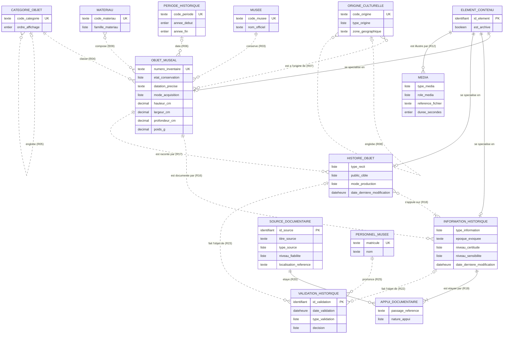

**Points de lecture**

- Les **sources** s'attachent aux **informations** (faits), jamais directement aux histoires. Une histoire hérite donc de la traçabilité des faits sur lesquels elle s'appuie (R18 + R19).
- Les **médias** s'attachent au supertype `ELEMENT_CONTENU` : un objet, une histoire, une information ou un avatar peuvent en avoir (R12).
- Les **textes** (titre, description, récit, énoncé) sont dans `TRADUCTION`, non représentée ici (voir § 11.6).

**Contraintes métier de ce diagramme** : CI-03, CI-18 (une histoire n'utilise que des informations de son objet), CI-19 (au moins une source), CI-21 (hiérarchies sans cycle), CI-22 (pas de média sur un média), CI-31 et CI-33.

### 11.2 Diagramme n° 3 — QR Code → Objet → Avatar IA

#### Structure de données

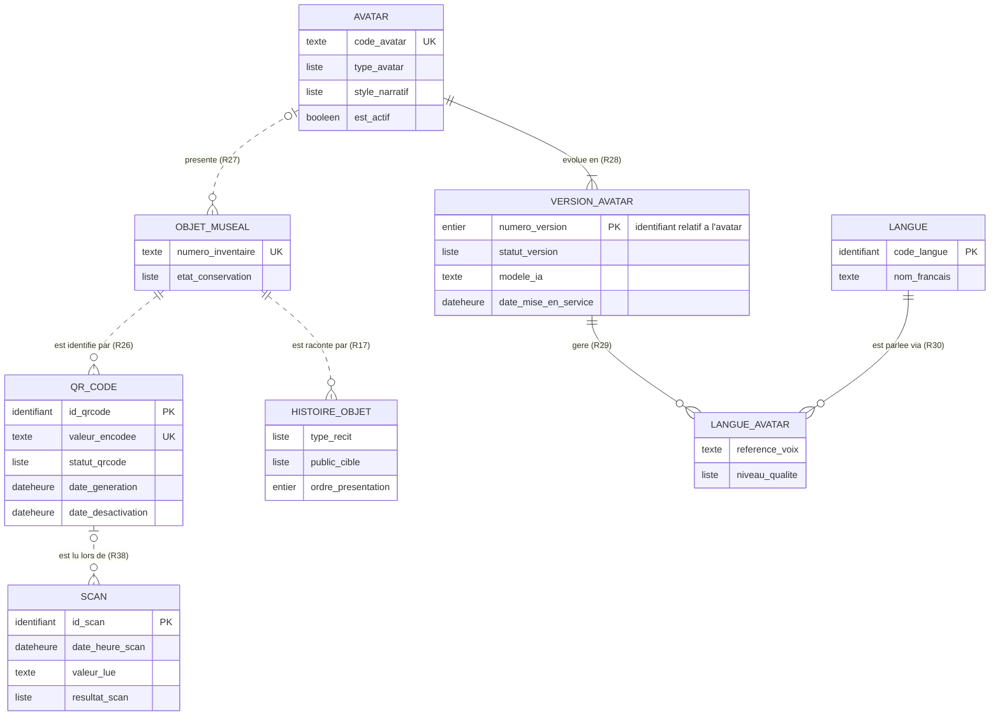

**Chaîne de résolution** : `SCAN` → `QR_CODE` (R38) → `OBJET_MUSEAL` (R26) → `HISTOIRE_OBJET` (R17) et `AVATAR` (R27) → `VERSION_AVATAR` en production (R28, CI-23) → `LANGUE_AVATAR` pour la langue choisie (R29, R30).

**Contraintes métier** : CI-12, CI-13, CI-14, CI-23, CI-24.

#### Déroulement fonctionnel

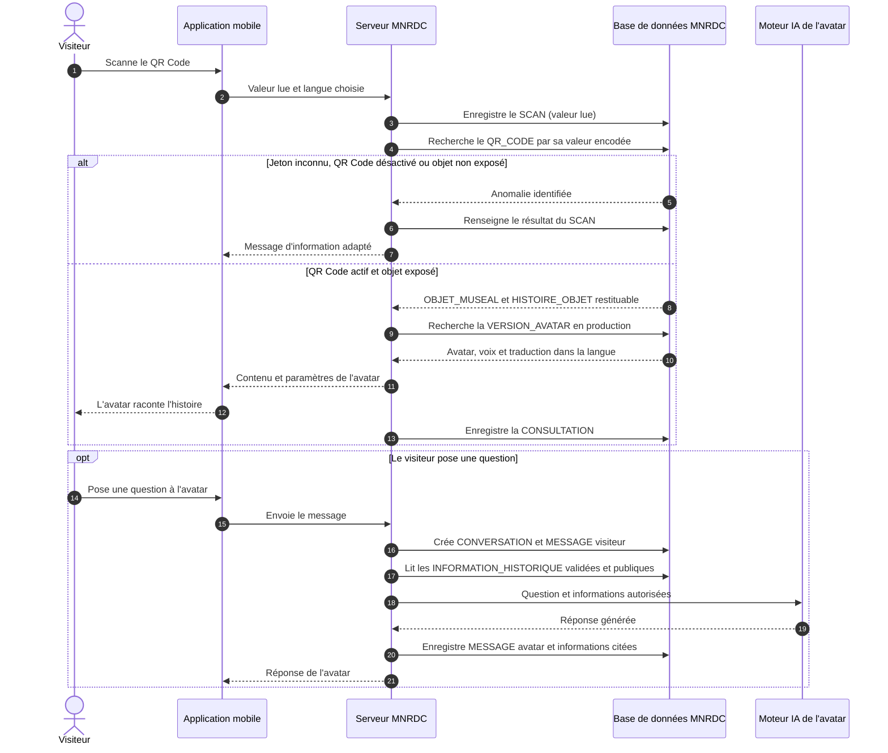

### 11.3 Diagramme n° 4 — Interactions Visiteur → Scan

#### Structure de données

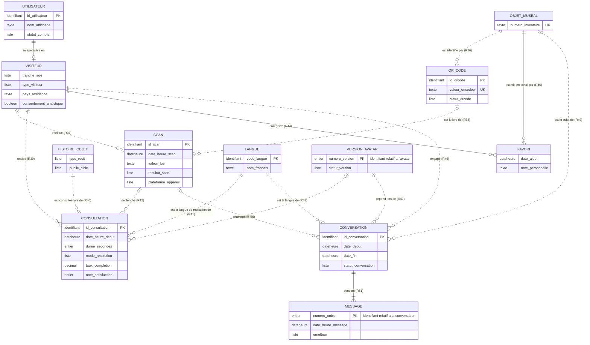

**Points de lecture**

- Le **scan** n'est pas associé directement à l'objet : l'objet est obtenu par `QR_CODE` (A05). Ce choix évite une redondance et garde la trace de ce qui a réellement été lu.
- Une **consultation** et une **conversation** peuvent exister **sans scan** (R42, R50 en (0,1)) : par exemple après une recherche ou depuis un favori.
- Un même visiteur peut scanner le même objet plusieurs fois (RG-V01).

**Contraintes métier** : CI-25, CI-26, CI-27, CI-29.

#### Résultats possibles d'un scan

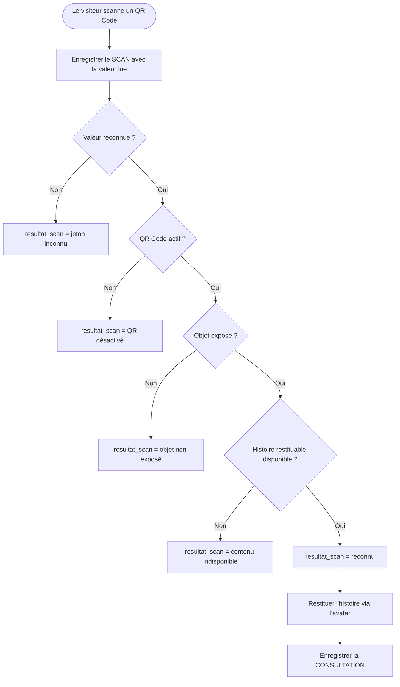

### 11.4 Diagramme n° 5 — Utilisateurs, administrateurs et conservateurs

#### Structure de données

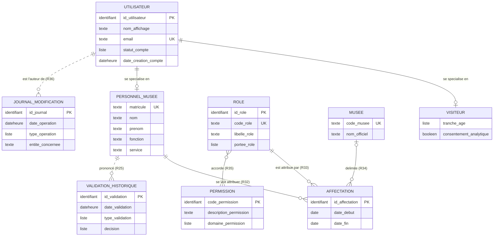

**Administrateur et conservateur** sont des **occurrences de `ROLE`** (A01), pas des entités. L'affectation est un lien daté entre une personne, un rôle et, selon la portée, un musée.

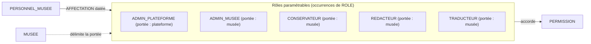

**Configuration initiale indicative** (ces données sont **paramétrables**, ce ne sont pas des structures du modèle) :

| Permission | ADMIN_PLATEFORME | ADMIN_MUSEE | CONSERVATEUR | REDACTEUR | TRADUCTEUR |
|---|:---:|:---:|:---:|:---:|:---:|
| `GERER_PLATEFORME` | ✔ | | | | |
| `GERER_LANGUES` | ✔ | | | | |
| `GERER_AVATARS` | ✔ | | | | |
| `GERER_UTILISATEURS` | ✔ | ✔ | | | |
| `GERER_MUSEE` (salles, emplacements) | ✔ | ✔ | | | |
| `GERER_QRCODES` | ✔ | ✔ | ✔ | | |
| `CREER_CONTENU` | | ✔ | ✔ | ✔ | |
| `MODIFIER_CONTENU` | | ✔ | ✔ | ✔ | |
| `VALIDER_SCIENTIFIQUE` | | | ✔ | | |
| `VALIDER_CULTUREL` | | | ✔ | | |
| `TRADUIRE` | | | | | ✔ |
| `VALIDER_LINGUISTIQUE` | | | | | ✔ |
| `CONSULTER_STATISTIQUES` | ✔ | ✔ | | | |
| `CONSULTER_JOURNAL` | ✔ | ✔ | ✔ | | |

#### Cycle de validation d'un contenu historique

Les états ci-dessous sont **dérivés** des enregistrements de `VALIDATION_HISTORIQUE` et de `date_derniere_modification`. Ils ne sont **pas stockés** (voir § 13.3).

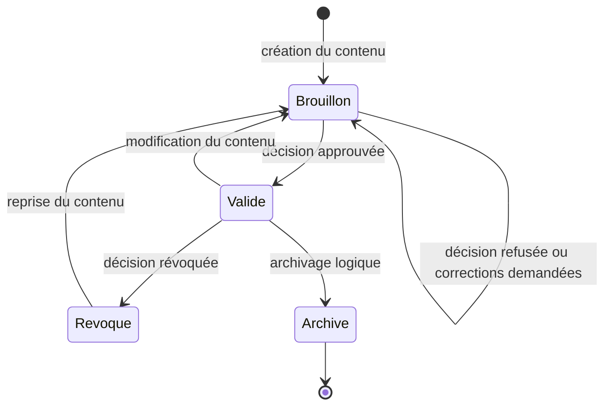

**Contraintes métier** : CI-02, CI-30, CI-31 (permission requise, séparation des tâches), CI-34.

### 11.5 Diagramme n° 6 — Système multilingue

#### Structure de données

```mermaid
erDiagram
    LANGUE {
        identifiant code_langue PK
        texte nom_francais
        texte nom_natif
        liste statut_linguistique
        liste sens_ecriture
        booleen est_active
    }
    ELEMENT_CONTENU {
        identifiant id_element PK
        booleen est_archive
    }
    TRADUCTION {
        texte intitule
        texte resume
        texte texte_complet
        liste nature_texte
        dateheure date_derniere_modification
    }
    MUSEE {
        texte code_musee UK
    }
    SALLE {
        texte code_salle
    }
    OBJET_MUSEAL {
        texte numero_inventaire UK
    }
    CATEGORIE_OBJET {
        texte code_categorie UK
    }
    PERIODE_HISTORIQUE {
        texte code_periode UK
    }
    ORIGINE_CULTURELLE {
        texte code_origine UK
    }
    MATERIAU {
        texte code_materiau UK
    }
    MEDIA {
        liste type_media
        liste role_media
    }
    INFORMATION_HISTORIQUE {
        liste niveau_sensibilite
    }
    HISTOIRE_OBJET {
        liste type_recit
    }
    AVATAR {
        texte code_avatar UK
    }
    SOURCE_DOCUMENTAIRE {
        identifiant id_source PK
        texte titre_source
    }
    VALIDATION_HISTORIQUE {
        identifiant id_validation PK
        liste type_validation
        liste decision
    }
    UTILISATEUR {
        identifiant id_utilisateur PK
        texte nom_affichage
    }
    VERSION_AVATAR {
        entier numero_version PK "identifiant relatif a l'avatar"
        liste statut_version
    }
    LANGUE_AVATAR {
        texte reference_voix
        liste niveau_qualite
    }
    CONSULTATION {
        identifiant id_consultation PK
        liste mode_restitution
    }
    CONVERSATION {
        identifiant id_conversation PK
        liste statut_conversation
    }

    ELEMENT_CONTENU ||--o| MUSEE : "se specialise en"
    ELEMENT_CONTENU ||--o| SALLE : "se specialise en"
    ELEMENT_CONTENU ||--o| OBJET_MUSEAL : "se specialise en"
    ELEMENT_CONTENU ||--o| CATEGORIE_OBJET : "se specialise en"
    ELEMENT_CONTENU ||--o| PERIODE_HISTORIQUE : "se specialise en"
    ELEMENT_CONTENU ||--o| ORIGINE_CULTURELLE : "se specialise en"
    ELEMENT_CONTENU ||--o| MATERIAU : "se specialise en"
    ELEMENT_CONTENU ||--o| MEDIA : "se specialise en"
    ELEMENT_CONTENU ||--o| INFORMATION_HISTORIQUE : "se specialise en"
    ELEMENT_CONTENU ||--o| HISTOIRE_OBJET : "se specialise en"
    ELEMENT_CONTENU ||--o| AVATAR : "se specialise en"
    ELEMENT_CONTENU ||--|{ TRADUCTION : "est exprime par (R14)"
    LANGUE ||--o{ TRADUCTION : "est la langue de (R15)"
    LANGUE |o..o{ MEDIA : "est la langue parlee de (R13)"
    LANGUE |o..o{ SOURCE_DOCUMENTAIRE : "est la langue de (R21)"
    TRADUCTION |o..o{ VALIDATION_HISTORIQUE : "fait l'objet de (R24)"
    VERSION_AVATAR ||--o{ LANGUE_AVATAR : "gere (R29)"
    LANGUE ||--o{ LANGUE_AVATAR : "est parlee via (R30)"
    LANGUE |o..o{ UTILISATEUR : "est preferee par (R31)"
    LANGUE ||..o{ CONSULTATION : "est la langue de restitution de (R41)"
    LANGUE ||..o{ CONVERSATION : "est la langue de (R48)"
```

**Principe.** Les entités patrimoniales ne contiennent **aucun texte public**. Tout texte vit dans `TRADUCTION`, identifiée par le couple (élément, langue). Ajouter le lingala, le tshiluba ou toute autre langue revient à **créer une occurrence de `LANGUE`** puis des occurrences de `TRADUCTION` : **aucune entité, aucun attribut, aucune association n'est modifié**.

**Quatre usages de la langue sont distingués :**

| Usage | Association | Rôle |
|---|---|---|
| Langue d'un texte | R15 | Rédaction des traductions |
| Langue d'un média | R13 | Narrations audio ou vidéo propres à une langue |
| Langue parlée par un avatar | R29 + R30 | Voix disponibles par version |
| Langue de service au visiteur | R31, R41, R48 | Préférence, consultation, conversation |

**Contraintes métier** : CI-08, CI-20, CI-25 (la langue d'une consultation doit être servable), CI-26, CI-32.

#### Chaîne de repli linguistique

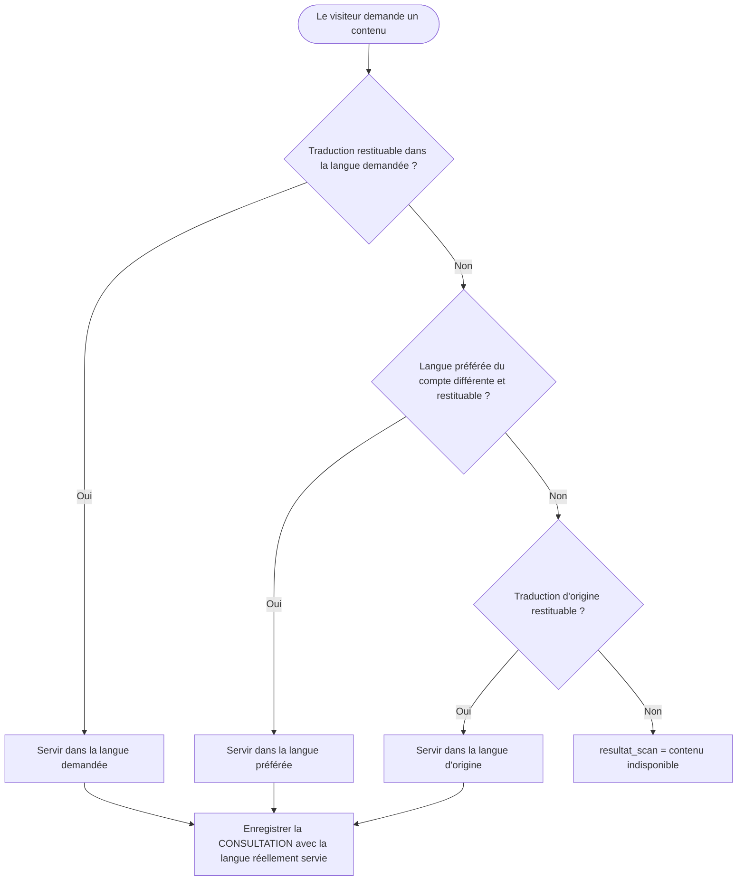

---

## 12. Justification des choix de modélisation

### 12.1 Justification des entités

| Entité | Pourquoi elle existe | Contribution au système |
|---|---|---|
| `ELEMENT_CONTENU` | 11 entités ont besoin de textes traduits et de médias | Un seul mécanisme de traduction et de médias, extensible |
| `LANGUE` | Le multilinguisme est une exigence centrale | Ajout de langues sans changement de modèle |
| `TRADUCTION` | Séparer le sens (neutre) de son expression (textuelle) | Tous les textes publics, avec nature et date |
| `JOURNAL_MODIFICATION` | Traçabilité exigée | Audit, responsabilité, restauration d'historique |
| `OBJET_MUSEAL` | Unité centrale du patrimoine | Cible du scan, des favoris, des conversations |
| `CATEGORIE_OBJET` | Navigation et classification | Filtrage et regroupement |
| `PERIODE_HISTORIQUE` | Datation structurée, comparable | Frises, recherche par époque |
| `ORIGINE_CULTURELLE` | Contexte culturel de l'objet | Médiation, cartographie, recherche |
| `MATERIAU` | Évite un attribut multivalué | Recherche par matière, conservation |
| `MEDIA` | Illustrer, narrer, animer | Images, voix, vidéos, ressources 3D de l'avatar |
| `INFORMATION_HISTORIQUE` | Unité de connaissance sourcée et validable | Fondation factuelle des récits et des réponses de l'IA |
| `HISTOIRE_OBJET` | Récit destiné à être raconté | Contenu principal restitué par l'avatar |
| `SOURCE_DOCUMENTAIRE` | Exigence de sources | Crédibilité scientifique |
| `APPUI_DOCUMENTAIRE` | Précision du passage d'une source | Vérifiabilité fine |
| `VALIDATION_HISTORIQUE` | Contrôle qualité par des personnes habilitées | Condition de publication |
| `MUSEE` | Plateforme multi-musées | Extension au-delà du MNRDC |
| `SALLE` | Structure physique du musée | Parcours, regroupement |
| `EMPLACEMENT` | Localiser précisément l'objet | Aide à l'orientation, gestion des vitrines |
| `PLACEMENT` | Historique des déplacements | Savoir où était l'objet à une date donnée |
| `QR_CODE` | Pont entre le monde physique et la base | Point d'entrée de l'expérience visiteur |
| `UTILISATEUR` | Mécanisme de compte unique | Authentification, préférence de langue, traçabilité |
| `PERSONNEL_MUSEE` | Distinguer le personnel des visiteurs | Responsable des contenus et validations |
| `ROLE`, `PERMISSION` | Droits paramétrables | Administrateurs, conservateurs et rôles futurs sans refonte |
| `AFFECTATION` | Rôles datés et par musée | Droits exacts à une date donnée |
| `VISITEUR` | Profil d'usage, y compris anonyme | Adaptation des récits, consentement |
| `SCAN` | Trace de chaque lecture de QR Code | Mesure d'usage, détection d'anomalies |
| `CONSULTATION` | Trace de la restitution d'une histoire validée | Statistiques par histoire, satisfaction |
| `FAVORI` | Mémoire personnelle du visiteur | Fidélisation, parcours personnalisé |
| `AVATAR` | Personnage présentateur | Incarnation de la médiation |
| `VERSION_AVATAR` | Évolution des modèles d'IA et des consignes | Mise à jour sans perte de l'historique |
| `LANGUE_AVATAR` | Capacités linguistiques variables par version | Choix de voix et de qualité |
| `CONVERSATION`, `MESSAGE` | Dialogue interactif avec l'avatar | Questions-réponses tracées et modérables |

### 12.2 Choix structurants

| Choix | Alternative écartée | Raison |
|---|---|---|
| Supertype `ELEMENT_CONTENU` | Une table de traductions par entité | Évite 11 structures quasi identiques ; une seule règle de repli linguistique |
| Textes uniquement dans `TRADUCTION` | Attributs `nom_fr`, `nom_en`… | Les colonnes par langue violent l'extensibilité et la normalisation |
| `ROLE` / `PERMISSION` / `AFFECTATION` | Entités `ADMINISTRATEUR` et `CONSERVATEUR` | Rôles figés, doublons de comptes, pas de portée par musée |
| Scan lié au **QR Code** (non à l'objet) | Scan lié à l'objet | Redondance, perte du jeton réellement lu |
| Plusieurs QR Codes dans le temps, un seul actif | Un QR Code par objet, définitif | Un autocollant abîmé doit pouvoir être remplacé sans perdre l'historique |
| `INFORMATION_HISTORIQUE` séparée de `HISTOIRE_OBJET` | Un seul bloc de texte par objet | Sources et sensibilité s'attachent à des faits ; plusieurs récits réutilisent les mêmes faits |
| `CONSULTATION` distincte de `CONVERSATION` | Tout dans les conversations | Lire un contenu validé et générer une réponse ont des risques et des traces différents |
| Versions d'avatar | Modifier l'avatar en place | Impossible d'auditer une réponse passée sans la version qui l'a produite |
| `PLACEMENT` historisé | Position courante dans l'objet | Perte de l'historique des déplacements |
| Journal à référence descriptive | Une association par entité tracée | Explosion d'associations ; survit à l'archivage |
| États de publication **dérivés** | Attribut `statut` sur chaque contenu | Redondance avec `VALIDATION_HISTORIQUE`, risque d'incohérence |
| Langues d'un objet **dérivées** | Association objet–langue | Redondance avec `TRADUCTION` |

### 12.3 Respect de la normalisation

- **1FN** : aucun attribut multivalué (matériaux, origines, langues, sources sont des entités ou associations).
- **2FN** : les entités associatives portent uniquement des attributs dépendants de **l'ensemble** de leur identifiant (par exemple `passage_reference` dépend du couple information–source).
- **3FN** : les attributs qui se déduisent d'autres données ne sont pas stockés (état de publication, langues disponibles, objet d'un scan, objet exposé, statistiques).
- **Duplications assumées** : `date_derniere_modification` sur trois entités. Ce choix est **nécessaire** pour comparer une modification à une validation sans parcourir le journal.

---

## 13. Contraintes d'intégrité conceptuelles

### 13.1 Catalogue des contraintes

#### Généralisations et exclusions

| Réf. | Nature | Énoncé |
|---|---|---|
| **CI-01** | Partition exclusive totale | Tout `ELEMENT_CONTENU` est exactement l'un des 11 sous-types de G01. |
| **CI-02** | Partition exclusive totale | Tout `UTILISATEUR` est exactement un `VISITEUR` ou un `PERSONNEL_MUSEE`. |
| **CI-03** | Exclusion et totalité | Toute `VALIDATION_HISTORIQUE` cible **exactement une** occurrence parmi `INFORMATION_HISTORIQUE`, `HISTOIRE_OBJET`, `TRADUCTION`. Le type `linguistique` ne s'applique qu'à une `TRADUCTION` ; les types `scientifique` et `culturelle` s'appliquent aux informations et aux histoires. |

#### Unicité

| Réf. | Nature | Énoncé |
|---|---|---|
| **CI-04** | Unicité | (`MUSEE`, `numero_inventaire`) est unique. |
| **CI-05** | Unicité | (`MUSEE`, `code_salle`) est unique. |
| **CI-06** | Unicité | (`SALLE`, `code_emplacement`) est unique (identifiant relatif). |
| **CI-07** | Unicité | `valeur_encodee` d'un `QR_CODE` est unique sur toute la plateforme. |
| **CI-08** | Unicité | Il existe au plus une `TRADUCTION` par couple (`ELEMENT_CONTENU`, `LANGUE`). |
| **CI-09** | Unicité | Un `VISITEUR` n'a qu'un seul `FAVORI` par objet. |
| **CI-10** | Unicité | (`AVATAR`, `numero_version`) et (`CONVERSATION`, `numero_ordre`) sont uniques. |
| **CI-11** | Unicité | Les codes naturels (`code_musee`, `code_categorie`, `code_periode`, `code_origine`, `code_materiau`, `code_avatar`, `code_role`, `matricule`, `code_langue`) sont uniques. `email` est unique s'il est renseigné. |

#### QR Codes et localisation

| Réf. | Nature | Énoncé |
|---|---|---|
| **CI-12** | Cardinalité conditionnelle | Un objet a **au plus un** `QR_CODE` de statut `actif`. |
| **CI-13** | Cohérence inter-entités | Un `QR_CODE` ne peut être `actif` que si l'objet est **exposé** (placement courant dans une salle de type `exposition`). |
| **CI-14** | Immutabilité | Le lien `QR_CODE` → `OBJET_MUSEAL` est **non modifiable** : un jeton n'est jamais réattribué à un autre objet. |
| **CI-15** | Cardinalité conditionnelle | Un objet a **au plus un** `PLACEMENT` sans `date_fin`. Les périodes de placement d'un même objet ne se chevauchent pas. |
| **CI-16** | Capacité | Le nombre de placements courants d'un `EMPLACEMENT` n'excède pas `capacite_max`. |
| **CI-17** | Cohérence inter-entités | Le musée de l'emplacement du placement courant est le musée de l'objet (H07). |

#### Contenu patrimonial et multilinguisme

| Réf. | Nature | Énoncé |
|---|---|---|
| **CI-18** | Cohérence inter-entités | Toutes les informations utilisées par une `HISTOIRE_OBJET` (R18) concernent **le même objet** que l'histoire. |
| **CI-19** | Cardinalité minimale | Toute `INFORMATION_HISTORIQUE` a au moins un `APPUI_DOCUMENTAIRE`. |
| **CI-20** | Cardinalité conditionnelle | Tout `ELEMENT_CONTENU` a **exactement une** `TRADUCTION` de nature `original`. |
| **CI-21** | Acyclicité | Les hiérarchies `CATEGORIE_OBJET` (R05) et `ORIGINE_CULTURELLE` (R08) sont sans cycle ; aucune occurrence n'est son propre parent. |
| **CI-22** | Cohérence inter-entités | La cible d'un `MEDIA` (R12) n'est **pas** un `MEDIA`. `LANGUE` d'un média (R13) n'est renseignée que pour les types `audio`, `video` et `document`. |

#### Avatars et IA

| Réf. | Nature | Énoncé |
|---|---|---|
| **CI-23** | Cardinalité conditionnelle | Un avatar a **au plus une** `VERSION_AVATAR` de statut `en production`. |
| **CI-24** | Cohérence inter-entités | L'association avatar–objet (R27) n'est **effective** que si l'avatar est actif et possède une version en production ; sinon l'objet est présenté sans avatar. |
| **CI-25** | Cohérence inter-entités | Pour une `CONSULTATION` : (a) si un scan est renseigné, son résultat est `reconnu` et l'objet du scan (via `QR_CODE`) est l'objet de l'histoire ; (b) la langue est servable par la chaîne de repli (RG-L06) ; (c) si une version d'avatar est renseignée, elle est en production. |
| **CI-26** | Cohérence inter-entités | Pour une `CONVERSATION` : (a) si un scan est renseigné, son objet est l'objet de la conversation ; (b) la langue appartient aux `LANGUE_AVATAR` de la version d'avatar. |
| **CI-27** | Ordre et complétude | Les messages d'une conversation sont numérotés de façon continue ; une conversation a au moins un message à sa création ; un message `visiteur` émane du visiteur de la conversation. |
| **CI-28** | Cohérence inter-entités | Un `MESSAGE` n'est lié (R52) que s'il est émis par l'`avatar`, et seulement à des informations **restituables** et de niveau `public`, appartenant à l'objet de la conversation lorsqu'il est renseigné. |

#### Visiteurs, scans et utilisateurs

| Réf. | Nature | Énoncé |
|---|---|---|
| **CI-29** | Cohérence conditionnelle | Pour un `SCAN` : le lien vers `QR_CODE` est **absent si et seulement si** `resultat_scan` = `jeton inconnu`. |
| **CI-30** | Cohérence inter-entités | Pour une `AFFECTATION` : le musée est **obligatoire** si la portée du rôle est `musée`, **interdit** si elle est `plateforme` ; `date_fin` ≥ `date_debut` ; deux affectations identiques d'une même personne ne se chevauchent pas. |
| **CI-31** | Habilitation et séparation | Une `VALIDATION_HISTORIQUE` exige : (a) une affectation active à `date_validation` donnant la permission du type de validation (`VALIDER_SCIENTIFIQUE`, `VALIDER_CULTUREL`, `VALIDER_LINGUISTIQUE`), dans le musée concerné ; (b) que le validateur ne soit pas l'auteur de la dernière modification du contenu validé (journal) ; (c) pour être **restituable**, une décision `approuvée` postérieure à `date_derniere_modification`, non suivie d'une `révocation`. |

#### Dates, sensibilité, traçabilité

| Réf. | Nature | Énoncé |
|---|---|---|
| **CI-32** | Cohérence temporelle | `annee_fin` ≥ `annee_debut` ; `date_fin` ≥ `date_debut` (placements, affectations) ; `date_retrait` ≥ `date_mise_en_service` ; `date_fin` ≥ `date_debut` d'une conversation ; `date_desactivation` ≥ `date_generation`. |
| **CI-33** | Sensibilité | Une information de niveau `restreint` ou `sacré` n'est jamais restituée ni citée (R52). Une `HISTOIRE_OBJET` restituable ne s'appuie que sur des informations restituables de niveau `public`. |
| **CI-34** | Immutabilité | `JOURNAL_MODIFICATION` est en **ajout seul** : aucune entrée n'est modifiée ni supprimée. L'auteur est obligatoire. |
| **CI-35** | Intégrité référentielle conceptuelle | Aucun `ELEMENT_CONTENU` référencé n'est supprimé ; il est **archivé**. Un élément archivé n'est plus restitué. |

### 13.2 Récapitulatif des cardinalités critiques

| Exigence du cahier des charges | Cardinalités | Contrainte associée |
|---|---|---|
| Un objet a un identifiant unique | `id_element` + (musée, `numero_inventaire`) | CI-04 |
| Un objet a plusieurs médias | `ELEMENT_CONTENU` (0,N) — `MEDIA` (1,1) | CI-22 |
| Un objet a plusieurs informations documentées | `OBJET_MUSEAL` (0,N) — `INFORMATION_HISTORIQUE` (1,1), et (1,N) vers les appuis | CI-19 |
| Un objet est associé à plusieurs langues | Dérivé de `TRADUCTION` (R14, R15) | CI-08, CI-20 |
| Un objet a un QR Code unique et actif | `OBJET_MUSEAL` (0,N) — `QR_CODE` (1,1) | CI-12, CI-13, CI-14 |
| Un objet a un avatar | `AVATAR` (0,N) — `OBJET_MUSEAL` (0,1) | CI-24 |
| Un avatar présente plusieurs objets | idem | A03 |
| Un visiteur scanne plusieurs objets | `VISITEUR` (0,N) — `SCAN` (1,1) | CI-29 |
| Un visiteur consulte plusieurs histoires | `VISITEUR` (0,N) — `CONSULTATION` (1,1) | CI-25 |
| Une conversation contient plusieurs messages | `CONVERSATION` (1,N) — `MESSAGE` (1,1) | CI-27 |
| Un administrateur ou conservateur valide | `PERSONNEL_MUSEE` (0,N) — `VALIDATION_HISTORIQUE` (1,1), droits via R32–R35 | CI-31 |
| Les sources sont conservées | `INFORMATION_HISTORIQUE` (1,N) — `APPUI_DOCUMENTAIRE` (1,1) | CI-19 |
| Contenus multilingues extensibles | `ELEMENT_CONTENU` (1,N) — `TRADUCTION` (1,1) — `LANGUE` (0,N) | CI-08, RG-L01 |

### 13.3 Données dérivées (non stockées)

| Donnée dérivée | Calcul |
|---|---|
| **Langues disponibles d'un élément** | Langues de ses traductions restituables |
| **État de publication** d'une information, d'une histoire ou d'une traduction | Dernière validation et `date_derniere_modification` : brouillon, validé, révoqué |
| **Objet exposé** | Placement courant dans une salle de type `exposition` |
| **Placement courant** | `PLACEMENT` sans `date_fin` |
| **QR Code actif d'un objet** | `QR_CODE` de statut `actif` |
| **Objet d'un scan** | `SCAN` → `QR_CODE` → `OBJET_MUSEAL` |
| **Avatar courant d'un objet** | Version `en production` de l'avatar associé |
| **Statistiques** (scans par objet, durée moyenne, satisfaction) | Agrégats sur `SCAN` et `CONSULTATION`, dans le respect de `consentement_analytique` |

---

## 14. Perspectives d'évolution

| Évolution | Impact prévu sur le modèle | Compatibilité |
|---|---|---|
| **Nouveaux musées** | Occurrences de `MUSEE`, `SALLE`, `AFFECTATION` | Aucune modification |
| **Nouvelles langues** | Occurrences de `LANGUE` et `TRADUCTION` | Aucune modification |
| **Nouveaux avatars et nouveaux modèles d'IA** | Occurrences de `AVATAR` et `VERSION_AVATAR` | Aucune modification |
| **Nouveaux rôles et permissions** | Occurrences de `ROLE`, `PERMISSION` | Aucune modification |
| **Nouveaux types de contenu patrimonial** (par exemple instruments de musique avec attributs propres) | Nouveau sous-type de `ELEMENT_CONTENU` | Extension de la généralisation |
| **Expositions temporaires** | Nouvelle entité `EXPOSITION` associée aux objets, avec dates | Extension |
| **Parcours de visite** | Entité `PARCOURS` ordonnée, liée aux objets et aux salles | Extension |
| **Prêts externes** | Entité `PRET` ou extension de `PLACEMENT` vers un lieu externe (levée de H07) | Extension |
| **Partage de médias entre éléments** | Remplacer R12 (1,1) par une association (0,N)–(0,N) portant le rôle et l'ordre (levée de A12) | Évolution contrôlée |
| **Communautés détentrices du savoir** | Entité `COMMUNAUTE` associée aux informations sensibles et aux validations culturelles | Extension |
| **Accessibilité** (langue des signes, audiodescription) | Nouveaux types et rôles de `MEDIA`, nouvelles langues (langues des signes) | Aucune ou faible |
| **Interopérabilité** avec les standards de métadonnées muséales | Correspondance de `OBJET_MUSEAL`, `PERIODE_HISTORIQUE`, `ORIGINE_CULTURELLE` avec des référentiels | Couche d'export |
| **Évaluation de la qualité de l'IA** | Entité d'évaluation reliée à `MESSAGE` | Extension |
| **Statistiques persistantes** | Si le volume l'exige, tables d'agrégats au niveau physique (MPD), sans modifier le MCD | Hors MCD |

---

## 15. Conclusion

Ce MCD structure le projet MNRDC autour d'un principe : **séparer le sens de son expression**. Les entités patrimoniales portent des faits neutres. Les textes, légendes et récits sont portés par des traductions. Les faits historiques sont **sourcés, classés par sensibilité et validés** avant d'être racontés par un avatar.

**Ce que le modèle garantit**

- Un objet est identifié sans ambiguïté, relié à un QR Code unique et actif, et présenté par au plus un avatar.
- Chaque information historique est étayée par au moins une source.
- Seuls les contenus validés et publics sont restitués ou cités par l'IA.
- Toute modification est tracée ; toute conversation conserve la version d'avatar utilisée.
- Musées, salles, langues, avatars et rôles peuvent être ajoutés sans modifier la structure.

**Points à valider avec les équipes métier avant le MLD**

1. Les rôles et permissions initiaux du § 11.4.
2. Les niveaux de sensibilité (`public`, `restreint`, `sacré`) et le processus de validation culturelle (H08).
3. Les valeurs des listes (états de conservation, types d'origine, modes d'acquisition…).
4. La politique de conservation des scans et des conversations, et le cadre de protection des données (H12).
5. L'abandon éventuel de l'hypothèse « un avatar maximum par objet » (H05).

**Étapes suivantes**

1. **MLD** : transformer les généralisations (choisir une stratégie de transposition), les entités associatives et les identifiants relatifs en relations ; ce choix appartient au MLD.
2. **MPD** : choisir le SGBD, typer les attributs, définir index et contraintes physiques ; y traiter aussi le stockage des médias et l'indexation pour l'IA.
3. **Implémentation** : traduire les contraintes de la section 13 en règles applicatives, déclencheurs ou contraintes déclaratives.